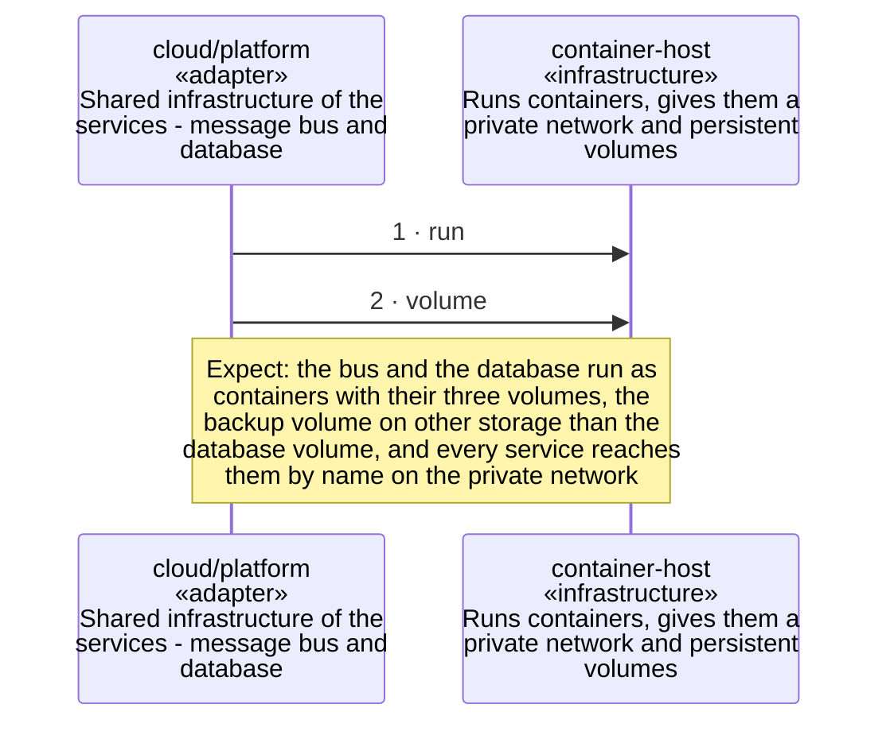

<!-- unifold:generated - do not edit; run `unifold generate` -->
# Scenario: start-the-server-side

**plantwatch** · [README](../../README.md) · [component](component.md) · [architecture](architecture.md)

**The container host starts the server side**
Source: deployment of cloud
Expect: the bus and the database run as containers with their three volumes, the backup volume on other storage than the database volume, and every service reaches them by name on the private network

A unit is named by its path from `plantwatch`; a capability or need of `plantwatch` is named bare. Every step is one hop along one connection of the map, drawn as the kind of its part says: a command or query goes from the caller to the target, and a dashed arrow brings the result of a query back; an event goes from the provider that raises it to the caller that receives it, with an open arrowhead. A bar is the time a lifeline is busy with a step; it ends when a lifeline further out makes the next step, and a unit below the busy one acts for it. An event from an idle lifeline lands on the bar of a busy receiver, or starts one.

| # | Caller | Target | Part | Kind | Contract |
|---|---|---|---|---|---|
| 1 | `cloud/platform` | `container-host` | `run` | command | [container-host](../references/container-host.md) |
| 2 | `cloud/platform` | `container-host` | `volume` | command | [container-host](../references/container-host.md) |
