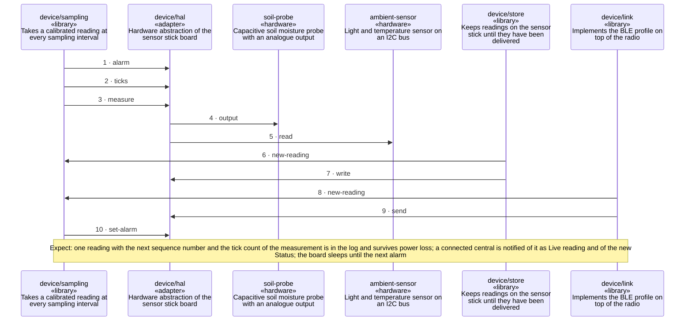

<!-- unifold:generated - do not edit; run `unifold generate` -->
# Scenario: take-a-reading

**plantwatch** · [README](../../README.md) · [component](component.md) · [architecture](architecture.md)

**The sensor stick wakes at the sampling time, takes a reading and stores it**
Source: runtime of device, the sleep and wake cycle
Expect: one reading with the next sequence number and the tick count of the measurement is in the log and survives power loss; a connected central is notified of it as Live reading and of the new Status; the board sleeps until the next alarm

A unit is named by its path from `plantwatch`; a capability or need of `plantwatch` is named bare. Every hop is a call along one connection of the map.

| # | Caller | Target | Part | Contract |
|---|---|---|---|---|
| 1 | `device/sampling` | `device/hal` | `alarm` | [timer](../../device/docs/references/timer.md) |
| 2 | `device/sampling` | `device/hal` | `ticks` | [timer](../../device/docs/references/timer.md) |
| 3 | `device/sampling` | `device/hal` | `measure` | [sensor-io](../../device/docs/references/sensor-io.md) |
| 4 | `device/hal` | `soil-probe` | `output` | [soil-probe](../references/soil-probe.md) |
| 5 | `device/hal` | `ambient-sensor` | `read` | [ambient-sensor](../references/ambient-sensor.md) |
| 6 | `device/store` | `device/sampling` | `new-reading` | [readings](../../device/docs/references/readings.md) |
| 7 | `device/store` | `device/hal` | `write` | [flash](../../device/docs/references/flash.md) |
| 8 | `device/link` | `device/sampling` | `new-reading` | [readings](../../device/docs/references/readings.md) |
| 9 | `device/link` | `device/hal` | `send` | [radio](../../device/docs/references/radio.md) |
| 10 | `device/sampling` | `device/hal` | `set-alarm` | [timer](../../device/docs/references/timer.md) |
