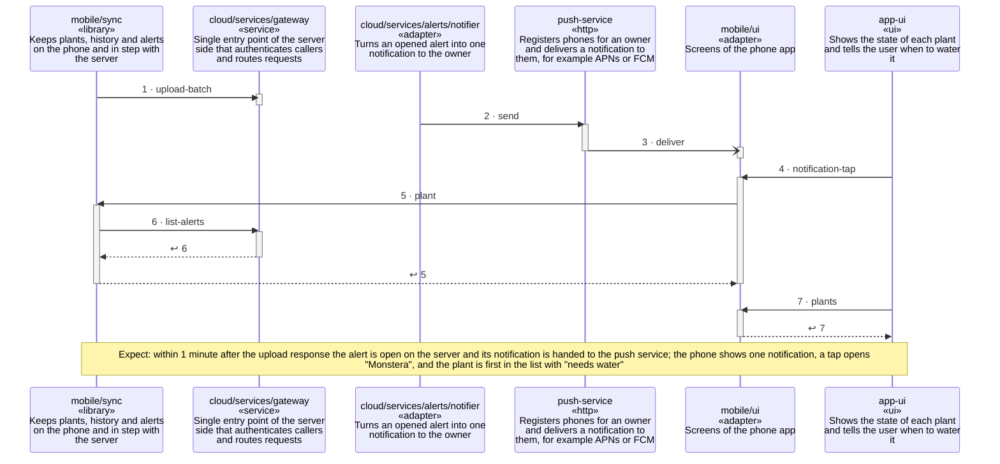

<!-- unifold:generated - do not edit; run `unifold generate` -->
# Scenario: upload-and-alert

**plantwatch** · [README](../../README.md) · [component](component.md) · [architecture](architecture.md)

**The phone uploads readings, the server opens an alert and the owner is notified once**
Source: requirements of plantwatch, the public API, consistency
Expect: within 1 minute after the upload response the alert is open on the server and its notification is handed to the push service; the phone shows one notification, a tap opens "Monstera", and the plant is first in the list with "needs water"

A unit is named by its path from `plantwatch`; a capability or need of `plantwatch` is named bare. Every step is one hop along one connection of the map, drawn as the kind of its part says: a command or query goes from the caller to the target, and a dashed arrow brings the result of a query back; an event goes from the provider that raises it to the caller that receives it, with an open arrowhead. A bar is the time a lifeline is busy with a step; it ends when a lifeline further out makes the next step, and a unit below the busy one acts for it.

| # | Caller | Target | Part | Kind | Contract |
|---|---|---|---|---|---|
| 1 | `mobile/sync` | `cloud/services/gateway` | `upload-batch` | command | [index](../references/public-api/index.md) |
| 2 | `cloud/services/alerts/notifier` | `push-service` | `send` | command | [push-service](../references/push-service.md) |
| 3 | `mobile/ui` | `push-service` | `deliver` | event | [push-service](../references/push-service.md) |
| 4 | `app-ui` | `mobile/ui` | `notification-tap` | command | [app-ui](../references/app-ui.md) |
| 5 | `mobile/ui` | `mobile/sync` | `plant` | query | [index](../../mobile/docs/references/plant-data/index.md) |
| 6 | `mobile/sync` | `cloud/services/gateway` | `list-alerts` | query | [index](../references/public-api/index.md) |
| 7 | `app-ui` | `mobile/ui` | `plants` | query | [app-ui](../references/app-ui.md) |
