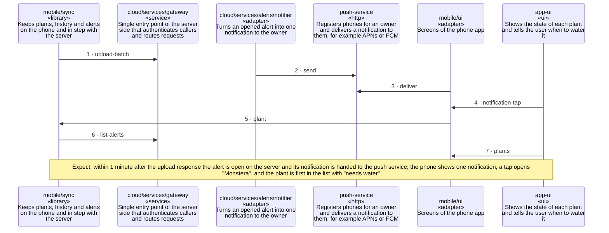

<!-- unifold:generated - do not edit; run `unifold generate` -->
# Scenario: upload-and-alert

**plantwatch** · [README](../../README.md) · [component](component.md) · [architecture](architecture.md)

**The phone uploads readings, the server opens an alert and the owner is notified once**
Source: requirements of plantwatch, the public API, consistency
Expect: within 1 minute after the upload response the alert is open on the server and its notification is handed to the push service; the phone shows one notification, a tap opens "Monstera", and the plant is first in the list with "needs water"

A unit is named by its path from `plantwatch`; a capability or need of `plantwatch` is named bare. Every hop is a call along one connection of the map.

| # | Caller | Target | Part | Contract |
|---|---|---|---|---|
| 1 | `mobile/sync` | `cloud/services/gateway` | `upload-batch` | [index](../references/public-api/index.md) |
| 2 | `cloud/services/alerts/notifier` | `push-service` | `send` | [push-service](../references/push-service.md) |
| 3 | `mobile/ui` | `push-service` | `deliver` | [push-service](../references/push-service.md) |
| 4 | `app-ui` | `mobile/ui` | `notification-tap` | [app-ui](../references/app-ui.md) |
| 5 | `mobile/ui` | `mobile/sync` | `plant` | [index](../../mobile/docs/references/plant-data/index.md) |
| 6 | `mobile/sync` | `cloud/services/gateway` | `list-alerts` | [index](../references/public-api/index.md) |
| 7 | `app-ui` | `mobile/ui` | `plants` | [app-ui](../references/app-ui.md) |
