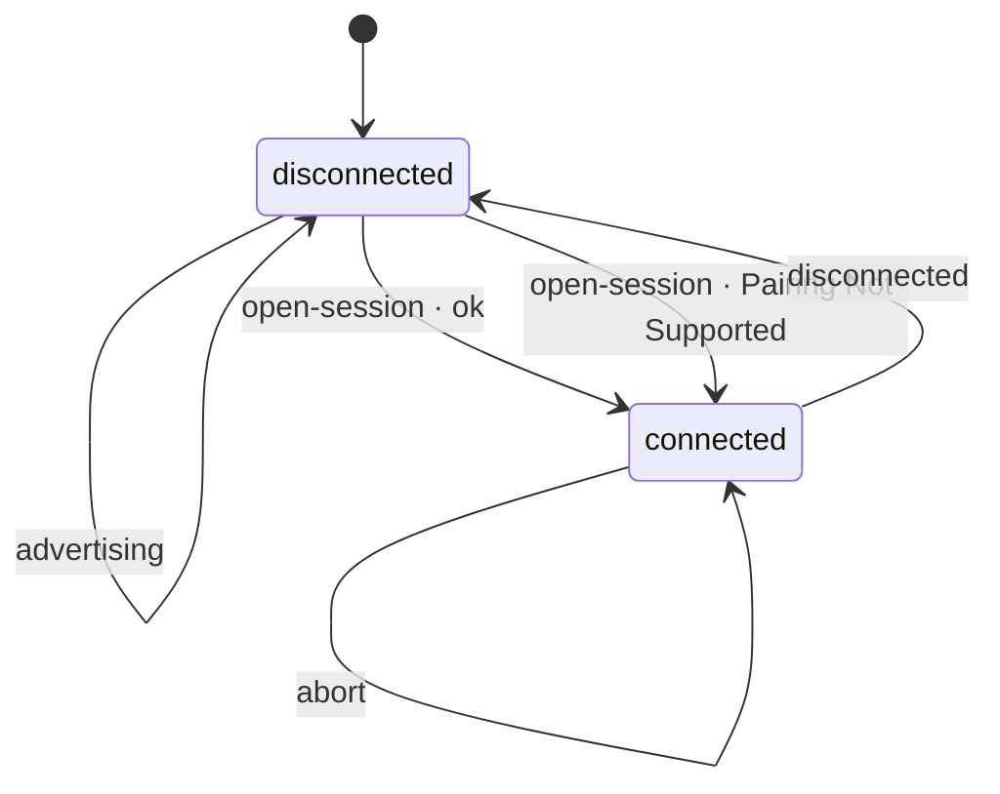

<!-- unifold:generated - do not edit; run `unifold check --fix` -->
# States: ble-profile

The states of the contract [ble-profile](../references/ble-profile/index.md): what a consumer can see of the connection, and the parts that move it from one state to the next. A part that a state does not list must not be called in it. A failure that the table does not name leaves the state as it is.

| State | Part | Result | Next |
|---|---|---|---|
| disconnected | `advertising` |  | disconnected |
| disconnected | `open-session` | ok | connected |
| disconnected | `open-session` | Pairing Not Supported | connected |
| connected | `info` |  | connected |
| connected | `status` |  | connected |
| connected | `time-reference` |  | connected |
| connected | `live-reading` |  | connected |
| connected | `fetch` |  | connected |
| connected | `confirm` |  | connected |
| connected | `abort` |  | connected |
| connected | `disconnected` |  | disconnected |
