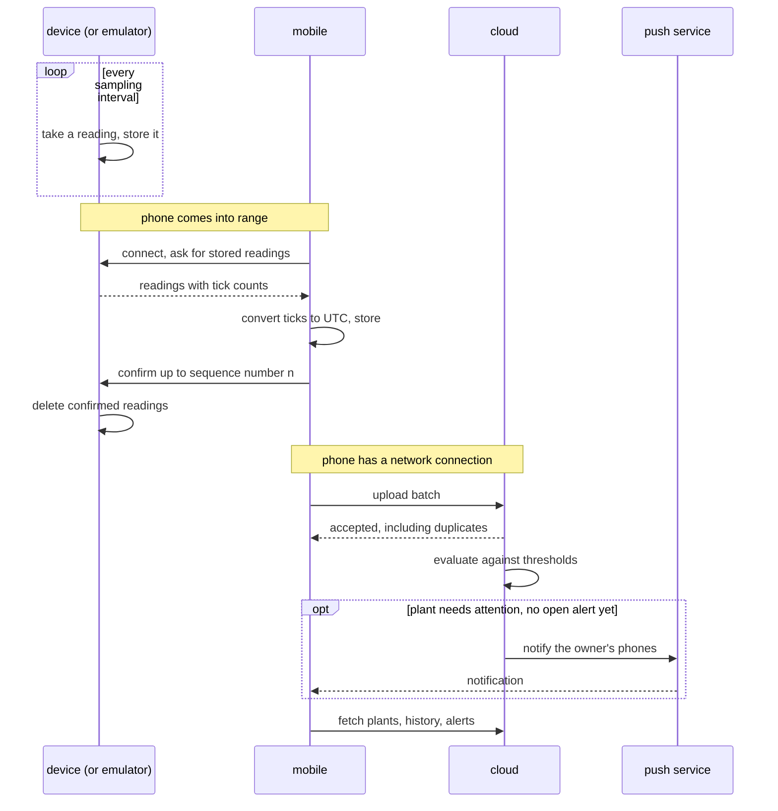

# Runtime of plantwatch

Scenarios that cross several parts and that no single part can tell. Which parts exist is in the [component diagram](../diagrams/component.md).

## The path of a reading

This sequence crosses several parts and is therefore drawn here. It shows only the parts directly inside plantwatch and the outside world.

