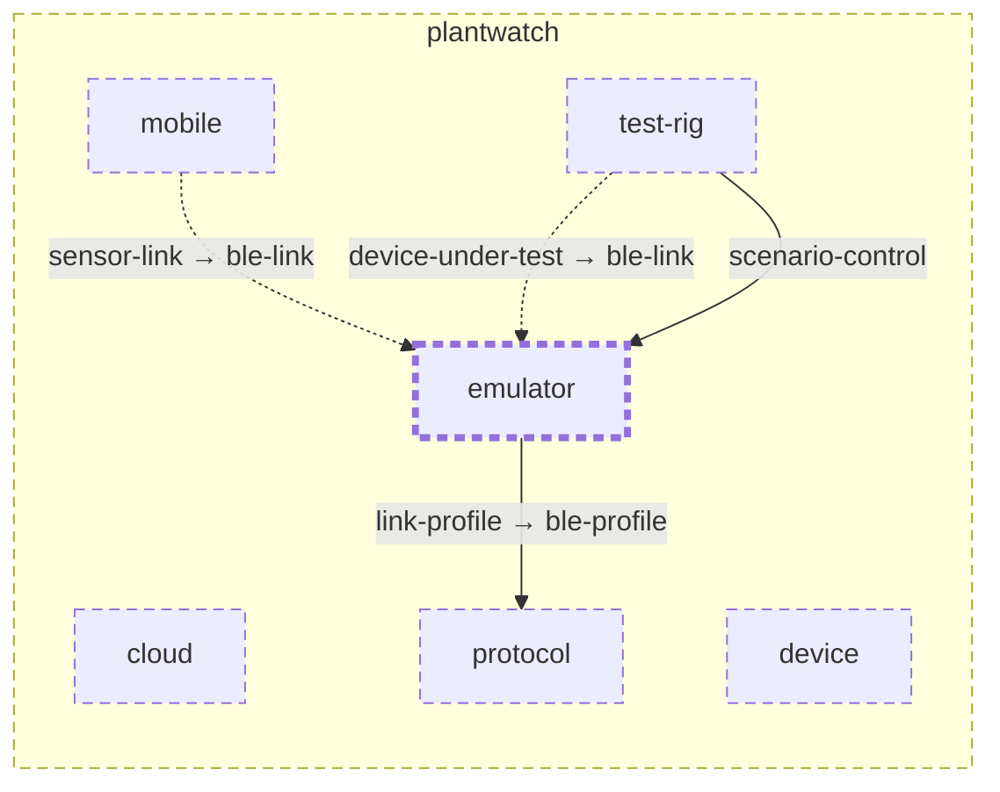

<!-- youmedoc:generated - do not edit; run `youmedoc generate` -->
# Context diagram: emulator

[emulator](../../README.md)

`emulator` among its siblings inside `plantwatch`. Only connections that touch `emulator` are drawn. Arrows point from the side that needs something to the side that provides it. Rounded nodes are ports the framing unit provides, hexagons are its needs. Dashed arrows are alternative providers; dashed borders mark planned units.

| Unit | Summary | Status | Diagram |
|---|---|---|---|
| [plantwatch](../../../README.md) | Tells people when their house plants need water, using a sensor in the pot, a phone app and cloud services | planned | [component](../../../doc/diagrams/component.md) |
| [cloud](../../../cloud/README.md) | Server side that stores readings, keeps the plant registry and raises alerts | planned | [component](../../../cloud/doc/diagrams/component.md) |
| [device](../../../device/README.md) | Firmware of the sensor stick that measures soil and surroundings and serves the readings over BLE | planned | [component](../../../device/doc/diagrams/component.md) |
| [emulator](../../README.md) | Desktop program that behaves like a sensor stick and is driven by a scenario instead of hardware | planned | [context](context.md) |
| [mobile](../../../mobile/README.md) | Phone app that collects readings from sensor sticks, shows the plants and relays data to the server | planned | [component](../../../mobile/doc/diagrams/component.md) |
| [protocol](../../../protocol/README.md) | Defines the BLE profile of the sensor stick and the format of a reading | planned | [context](../../../protocol/doc/diagrams/context.md) |
| [test-rig](../../../test-rig/README.md) | Runs end-to-end tests from the sensor link to the alert, against real or simulated hardware | planned | [context](../../../test-rig/doc/diagrams/context.md) |
