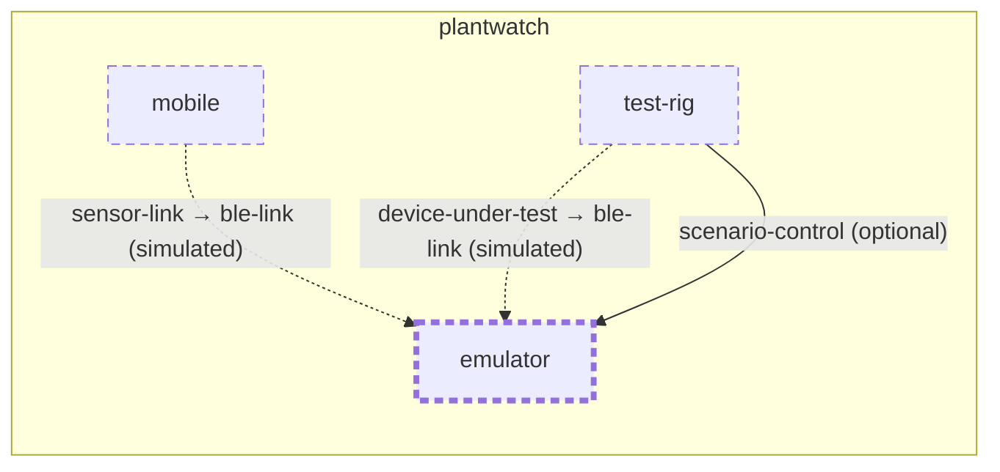

<!-- unifold:generated - do not edit; run `unifold generate` -->
# Context diagram: emulator

[plantwatch](../../../docs/diagrams/component.md) / **emulator** · [README](../../README.md)

`emulator` inside `plantwatch`, with the units it is connected to. An arrow points from the unit that needs something to the unit that provides it. Rounded nodes are capabilities of the framing unit, hexagons are its needs. A dashed arrow is an alternative provider; a dashed border marks a unit that is planned.

| Unit | Kind | Summary | Status | Diagram |
|---|---|---|---|---|
| [emulator](../../README.md) | tool | Desktop program that behaves like a sensor stick and is driven by a scenario instead of hardware | **planned** | [context](context.md) |
| [mobile](../../../mobile/README.md) | app | Phone app that collects readings from sensor sticks, shows the plants and relays data to the server | **planned** | [component](../../../mobile/docs/diagrams/component.md) |
| [test-rig](../../../test-rig/README.md) | test | Runs end-to-end tests from the sensor link to the alert, against real or simulated hardware | **planned** | [context](../../../test-rig/docs/diagrams/context.md) |

### Who uses what this unit provides

| Capability | Kind | Contract | Verified by | Used by | As need |
|---|---|---|---|---|---|
| ble-link | protocol | [contract](../../../docs/references/ble-profile/index.md) |  | [mobile/ble-client](../../../mobile/ble-client/README.md) (planned) (simulated) | sensor-link |
| ble-link | protocol | [contract](../../../docs/references/ble-profile/index.md) |  | [test-rig](../../../test-rig/README.md) (planned) (simulated) | device-under-test |
| scenario-control | http | [contract](../../../docs/references/scenario-control.md) |  | [test-rig](../../../test-rig/README.md) (planned) | scenario-control |
