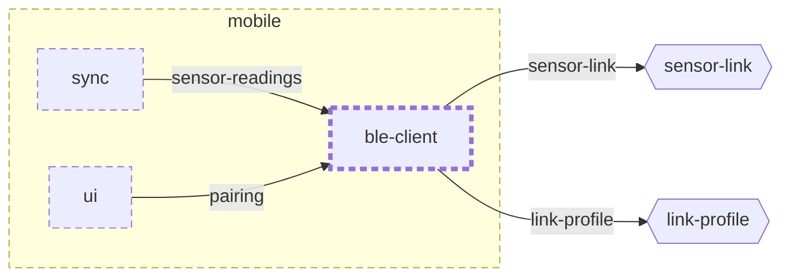

<!-- youmedoc:generated - do not edit; run `youmedoc generate` -->
# Context diagram: ble-client

[plantwatch](../../../../doc/diagrams/component.md) / [mobile](../../../doc/diagrams/component.md) / **ble-client** · [README](../../README.md)

`ble-client` among its siblings inside `mobile`. Only connections that touch `ble-client` are drawn. Arrows point from the side that needs something to the side that provides it. Rounded nodes are ports the framing unit provides, hexagons are its needs. A dashed arrow is an alternative provider; a dashed border marks a planned unit.

| Unit | Kind | Diagram |
|---|---|---|
| [mobile](../../../README.md) | app | [component](../../../doc/diagrams/component.md) |
| [ble-client](../../README.md) | library | [context](context.md) |
| [sync](../../../sync/README.md) | library | [context](../../../sync/doc/diagrams/context.md) |
| [ui](../../../ui/README.md) | library | [context](../../../ui/doc/diagrams/context.md) |

### Who provides what this unit needs

| Need | Kind | Own contract | Provided by | Port | Their contract |
|---|---|---|---|---|---|
| sensor-link | protocol |  | [device/link](../../../../device/link/README.md) (real) | ble-link |  |
| sensor-link | protocol |  | [emulator](../../../../emulator/README.md) (simulated) | ble-link |  |
| link-profile | specification |  | [protocol](../../../../protocol/README.md) | ble-profile | [contract](../../../../protocol/doc/references/ble-profile/index.md) |

### Who uses what this unit provides

| Port | Kind | Used by | As need | Their contract |
|---|---|---|---|---|
| sensor-readings | library | [mobile/sync](../../../sync/README.md) | sensor-readings |  |
| pairing | library | [mobile/ui](../../../ui/README.md) | pairing |  |
