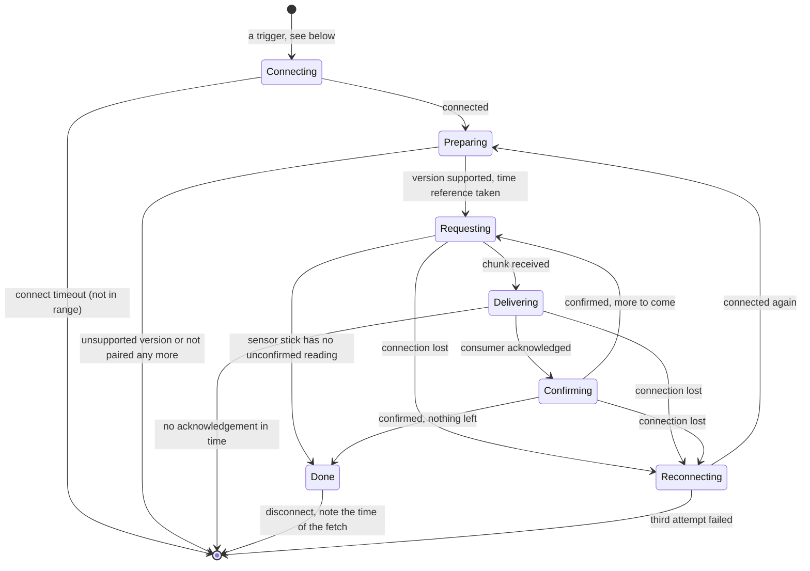

# Fetch session

The course of one fetch from one sensor stick: its states, sizes and
timeouts, what starts it, and how the client fills in what `link-profile`
leaves open. The reasons are in the [decisions](../decisions/index.md), the
terms in the [glossary](glossary.md). The procedures on the radio are those
of `link-profile`; this file names them without repeating them.

## States

| State | The client |
|---|---|
| Connecting | Connects to the sensor stick |
| Preparing | Opens a session and takes a time reference, both as `link-profile` defines; checks the major version and that the sensor stick still accepts this phone |
| Requesting | Asks for the next chunk, starting at the oldest reading the sensor stick holds unconfirmed |
| Delivering | Gives every reading its time, drops invalid readings, hands the batch to the consumer and waits |
| Confirming | Confirms to the sensor stick up to the highest sequence number of the chunk, including dropped readings |
| Reconnecting | Connects again and starts over at the oldest unconfirmed reading |
| Done | Disconnects and records the fetch |

A chunk in which every reading was dropped as invalid is confirmed without a
delivery.

## Sizes and timeouts

| Parameter | Value | Follows from |
|---|---|---|
| Readings per chunk | The largest batch the [contract](sensor-readings.md) allows | One chunk is fetched, delivered and confirmed inside one background slot |
| Connect timeout | 10 seconds | The owner waits on a screen for the outcome of "fetch now" |
| Acknowledgement timeout | As the [contract](sensor-readings.md) states | Half a background slot |
| Reconnect attempts per session | 3, without a pause | A sensor stick that is still in range answers at once |
| Sessions at a time | 1 | One radio, short slots |
| Disconnect after `Done` | At once | The sensor stick saves energy when no central is connected |

The background slot and its length are cited in [context.md](../explanation/context.md).

## What triggers a session

| Trigger | Sensor sticks |
|---|---|
| The operating system reports a paired sensor stick | That one |
| The operating system grants a slot of scheduled background work | All paired ones in range whose next reading is due |
| "Fetch now" of the [sensor-readings](sensor-readings.md) capability | The named one, or all paired ones in range |
| The program comes onto the screen, or a consumer attaches while it is there | All paired ones in range |
| A pairing succeeds | The new one |

A trigger for a sensor stick that already has a session, or that is already
in the queue, has no effect. When several sensor sticks wait, the client
takes the one whose last fetch lies furthest back first. A sensor stick
whose session ended with a failure goes to the end of the queue.

## Holding back the standing request

A sensor stick advertises whenever no central is connected. A standing
request that is set again right after a fetch would connect again at once.

| Situation | The client |
|---|---|
| A session ended in `Done` | Sets the standing request for this sensor stick again when its next reading is due: one sampling interval after its newest reading. The sensor stick states its sampling interval. |
| The program is suspended before that moment | Sets the request at its next wake-up for any reason, if the reading is due by then |
| A session ended early | Sets the request again at once |
| "Fetch now", or the program is on the screen | Fetches regardless of what is due |

## Time of a reading

`link-profile` defines how a central computes the time of a reading from a
time reference, and when a time counts as estimated. The client adds:

| Open point | The client |
|---|---|
| Which time references to keep | One anchor for each of the 8 most recent boots of each paired sensor stick. They are removed at unpairing. |
| The estimate for a reading of a boot without a reference | Start of the following boot minus the seconds between this reading and the last reading of its own boot that the sensor stick still holds |
| The start of the following boot is itself unknown | It is estimated in the same way first |

An estimate is the latest time the reading can have: it assumes that the
earlier boot ended with its last reading and that the following boot began
at once.

Examples, for a time reference "boot 12, 86 400 seconds" taken at
2026-10-06T07:15:00Z, so that boot 12 began at 2026-10-05T07:15:00Z:

| Reading | Anchors kept | Time | Estimated |
|---|---|---|---|
| Boot 12, 85 500 seconds | Any | 2026-10-06T07:00:00Z | No |
| Boot 11, 4 500 seconds | Boot 11: 3 600 seconds at 2026-10-01T10:00:00Z | 2026-10-01T10:15:00Z | No |
| Boot 11, 1 800 seconds, the last of its boot | None for boot 11 | 2026-10-05T07:15:00Z | Yes |
| Boot 11, 900 seconds | None for boot 11 | 2026-10-05T07:00:00Z | Yes |
