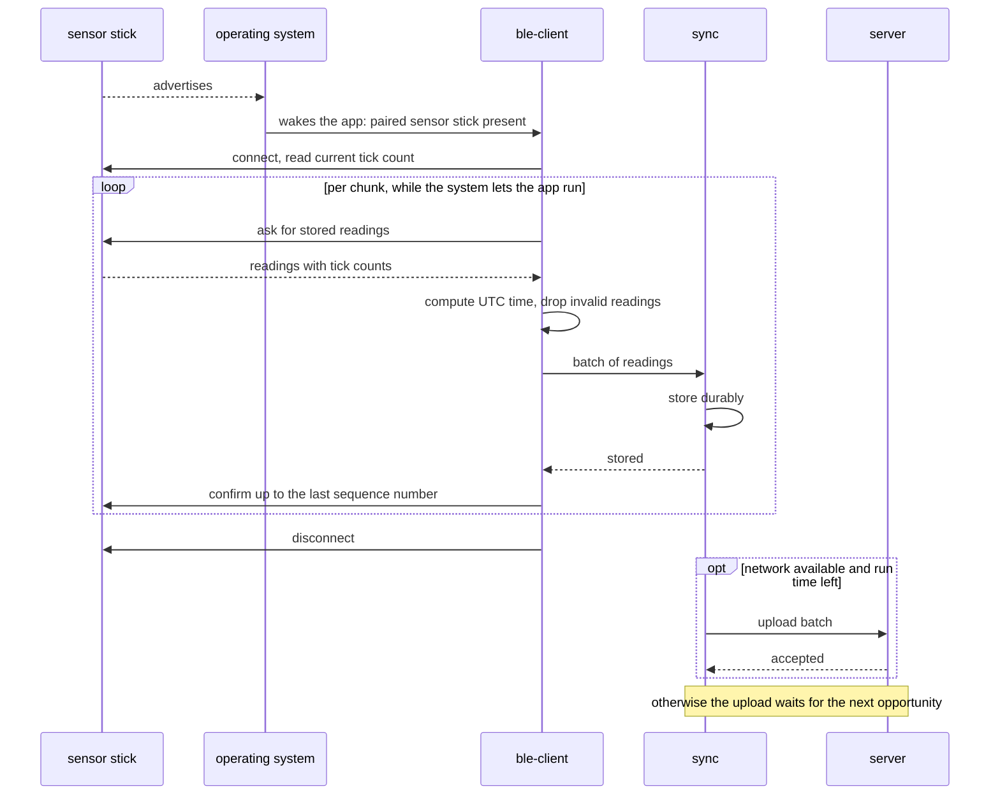
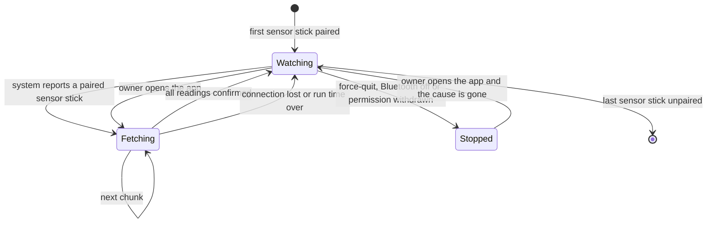
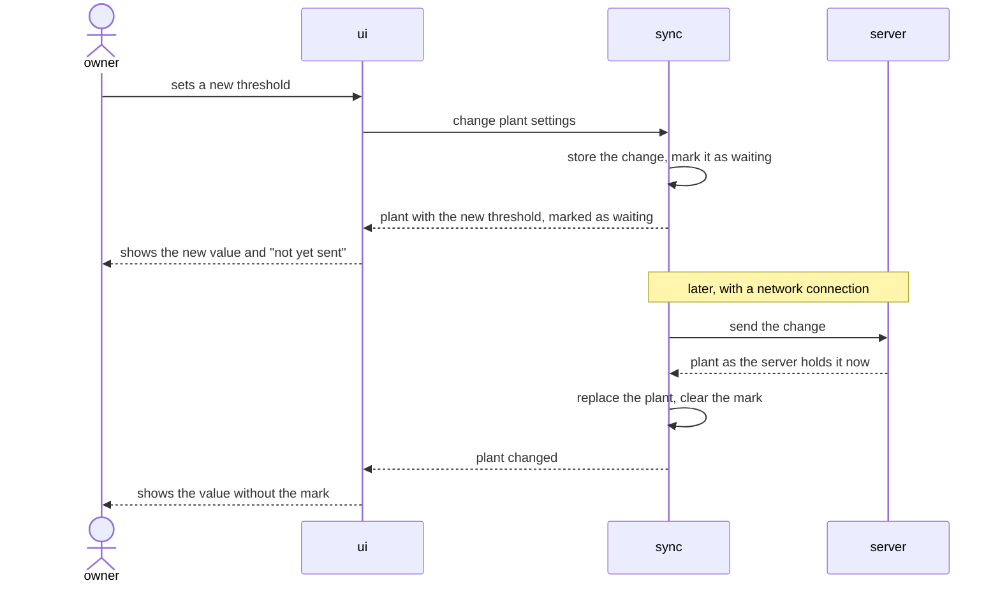

# Architecture of mobile

The long form of the why in [AGENTS.md](../AGENTS.md). Which parts exist and
how they are wired is shown in the [component diagram](diagrams/component.md).

## Reasoning

**Three rhythms, three parts.** Radio contact, network contact and the
owner's attention come and go independently. A design in which one of them
waits for another fails in daily use: a screen that waits for the radio
freezes when the sensor stick is out of range, and a fetch that waits for
the network loses its short background slot. Each rhythm therefore has a part
of its own, and the parts meet only at a store on the phone
([0001](decisions/0001-the-local-store-is-the-only-source-for-the-screens.md)).

**The operating system decides when the app runs.** In the background the
app runs only when the system wakes it, and only for a short time
([platform limits](references/platform-limits.md)). The app therefore lets
the system watch for paired sensor sticks and does the minimum in each slot:
fetch, store, confirm
([0002](decisions/0002-fetch-when-the-system-reports-a-paired-sensor-stick.md)).
Uploading is separate work that may happen in the same slot or hours later.

**Time is settled at the door.** Tick counts mean something only together
with the moment of the fetch. The part that fetches turns them into UTC. The
tick count travels on inside the reading, and nothing behind the fetch
computes with it
([0003](decisions/0003-a-reading-gets-its-time-before-it-is-stored.md)).

**Platform differences stay in one corner.** Background wake-up and BLE are
the only things that iOS and Android do in truly different ways. Everything
else is written once
([0004](decisions/0004-one-codebase-for-both-platforms.md)).

## Invariants

- The screens never talk to the radio or to the network. They read from the
  store on the phone and write to it.
- No part waits for another rhythm. A fetch does not wait for an upload, an
  upload does not wait for a fetch, a screen waits for neither.
- A reading is confirmed to the sensor stick only after it is stored durably
  on the phone. It is removed from the phone only after the server has
  confirmed it and it is older than the history the app keeps.
- A reading has its UTC time and its estimated flag before it is stored. Both
  never change afterwards.
- The app computes no alert. A plant "needs water" on a screen only because
  an open alert says so.
- Each thing in the [data model](references/data-model.md) has one origin.
  The app changes only what the owner may change.
- At most one fetch runs at a time, and at most one upload.

## Behaviour

The diagrams show the app's parts
[ble-client](../ble-client/README.md), [sync](../sync/README.md) and
[ui](../ui/README.md) as participants, next to the outside world.

### A paired sensor stick comes into range while the app is closed

### Background fetching as the system sees the app

In `Watching` the app does not run. The operating system holds the request
and starts the app when a paired sensor stick appears. A fetch that ends
early loses nothing: the sensor stick still holds every unconfirmed reading.

### The owner changes a threshold without a network connection

Until the server has the new threshold, alerts follow the old one. The
screen says so through the mark.

## What the split costs

- The phone holds a copy of server data, and the two can differ for days.
  The app shows the age of what it holds instead of hiding the difference.
- A reading passes through two hand-overs inside the app. Each one follows
  the rule "store, then confirm" and may repeat.
