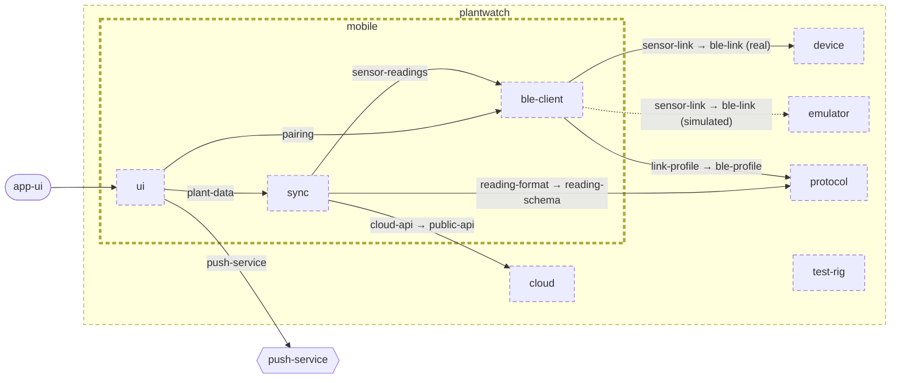

<!-- unifold:generated - do not edit; run `unifold generate` -->
# Architecture diagram: mobile

[plantwatch](../../../doc/diagrams/component.md) / **mobile** · [README](../../README.md) · [context](context.md) · [component](component.md)

`mobile` next to its siblings in `plantwatch`, opened up 3 level(s) down. Arrows point from the side that needs something to the side that provides it. Rounded nodes are ports the framing unit provides, hexagons are its needs. A dashed arrow is an alternative provider; a dashed border marks a planned unit.

| Unit | Kind | Diagram |
|---|---|---|
| [plantwatch](../../../README.md) | system | [component](../../../doc/diagrams/component.md) |
| [cloud](../../../cloud/README.md) | system | [component](../../../cloud/doc/diagrams/component.md) |
| [device](../../../device/README.md) | firmware | [component](../../../device/doc/diagrams/component.md) |
| [emulator](../../../emulator/README.md) | tool | [context](../../../emulator/doc/diagrams/context.md) |
| [mobile](../../README.md) | app | [component](component.md) |
| [ble-client](../../ble-client/README.md) | library | [context](../../ble-client/doc/diagrams/context.md) |
| [sync](../../sync/README.md) | library | [context](../../sync/doc/diagrams/context.md) |
| [ui](../../ui/README.md) | library | [context](../../ui/doc/diagrams/context.md) |
| [protocol](../../../protocol/README.md) | specification | [context](../../../protocol/doc/diagrams/context.md) |
| [test-rig](../../../test-rig/README.md) | test | [context](../../../test-rig/doc/diagrams/context.md) |
