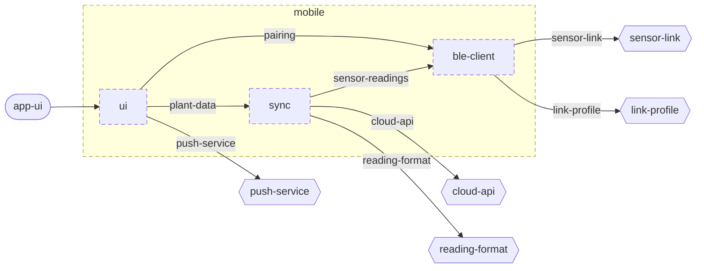

<!-- unifold:generated - do not edit; run `unifold generate` -->
# Component diagram: mobile

[plantwatch](../../../doc/diagrams/component.md) / **mobile** · [README](../../README.md) · [context](context.md) · [architecture](architecture.md)

The units directly inside `mobile` and how they are wired. Arrows point from the side that needs something to the side that provides it. Rounded nodes are ports the framing unit provides, hexagons are its needs. A dashed arrow is an alternative provider; a dashed border marks a planned unit.

| Unit | Kind | Summary | Status | Diagram |
|---|---|---|---|---|
| [mobile](../../README.md) | app | Phone app that collects readings from sensor sticks, shows the plants and relays data to the server | planned | [component](component.md) |
| [ble-client](../../ble-client/README.md) | library | Finds sensor sticks and fetches their readings over BLE | planned | [context](../../ble-client/doc/diagrams/context.md) |
| [sync](../../sync/README.md) | library | Keeps plants, history and alerts on the phone and in step with the server | planned | [context](../../sync/doc/diagrams/context.md) |
| [ui](../../ui/README.md) | library | Screens of the phone app | planned | [context](../../ui/doc/diagrams/context.md) |
