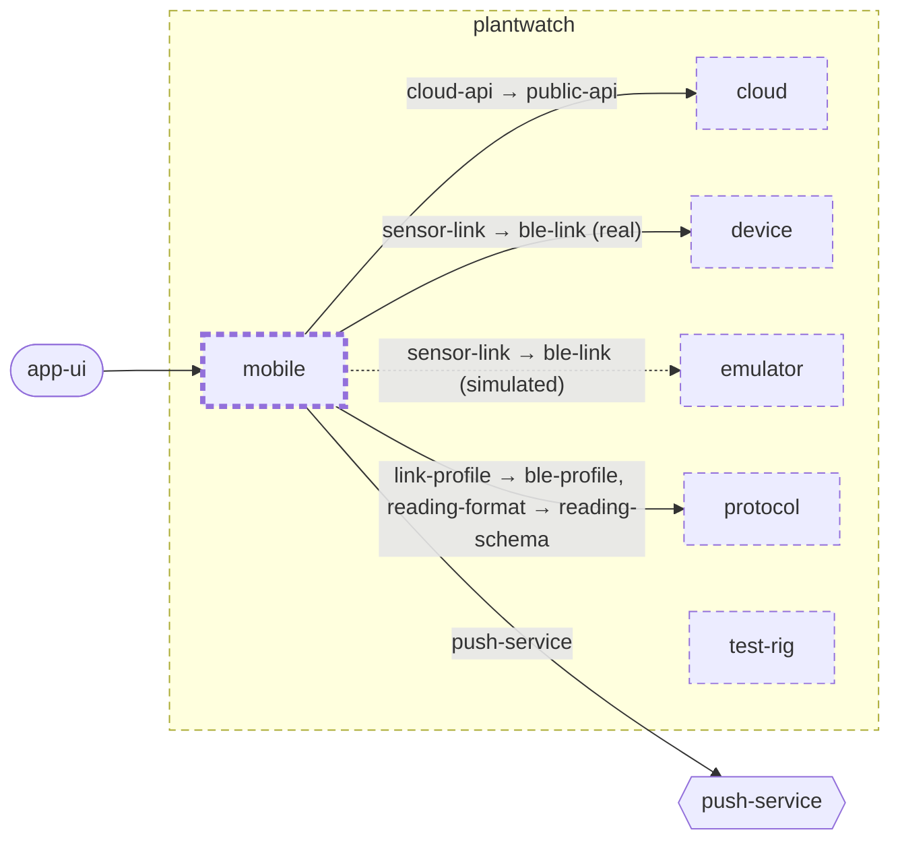

<!-- youmedoc:generated - do not edit; run `youmedoc generate` -->
# Context diagram: mobile

[plantwatch](../../../doc/diagrams/component.md) / **mobile** · [README](../../README.md) · [component](component.md) · [architecture](architecture.md)

`mobile` among its siblings inside `plantwatch`. Only connections that touch `mobile` are drawn. Arrows point from the side that needs something to the side that provides it. Rounded nodes are ports the framing unit provides, hexagons are its needs. A dashed arrow is an alternative provider; a dashed border marks a planned unit.

| Unit | Kind | Diagram |
|---|---|---|
| [plantwatch](../../../README.md) | system | [component](../../../doc/diagrams/component.md) |
| [cloud](../../../cloud/README.md) | system | [component](../../../cloud/doc/diagrams/component.md) |
| [device](../../../device/README.md) | firmware | [component](../../../device/doc/diagrams/component.md) |
| [emulator](../../../emulator/README.md) | tool | [context](../../../emulator/doc/diagrams/context.md) |
| [mobile](../../README.md) | app | [component](component.md) |
| [protocol](../../../protocol/README.md) | specification | [context](../../../protocol/doc/diagrams/context.md) |
| [test-rig](../../../test-rig/README.md) | test | [context](../../../test-rig/doc/diagrams/context.md) |

### Who provides what this unit needs

| Need | Kind | Own contract | Provided by | Port | Their contract |
|---|---|---|---|---|---|
| sensor-link | protocol |  | [device/link](../../../device/link/README.md) (real) | ble-link |  |
| sensor-link | protocol |  | [emulator](../../../emulator/README.md) (simulated) | ble-link |  |
| cloud-api | http |  | [cloud/services/gateway](../../../cloud/services/gateway/README.md) | public-api | [contract](../../../cloud/services/gateway/doc/references/public-api.md) |
| link-profile | specification |  | [protocol](../../../protocol/README.md) | ble-profile | [contract](../../../protocol/doc/references/ble-profile/index.md) |
| reading-format | specification |  | [protocol](../../../protocol/README.md) | reading-schema | [contract](../../../protocol/doc/references/reading-schema.md) |
| push-service | http |  | outside the project, as need `push-service` of the root | | |

### Who uses what this unit provides

| Port | Kind | Used by | As need | Their contract |
|---|---|---|---|---|
| app-ui | ui | outside the project, as port `app-ui` of the root | | |
