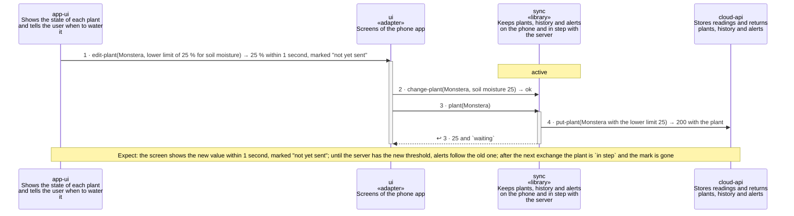

<!-- unifold:generated - do not edit; run `unifold check --fix` -->
# Scenario: change-a-threshold-offline

[plantwatch](../../../docs/diagrams/component.md) / **mobile** · [README](../../README.md) · [context](context.md) · [component](component.md)

**The owner changes a threshold without a network connection, and the change reaches the server later**
Source: decision 0001 of mobile
Given: `sync.plant-data` is active
Expect: the screen shows the new value within 1 second, marked "not yet sent"; until the server has the new threshold, alerts follow the old one; after the next exchange the plant is `in step` and the mark is gone

A unit is named by its path from `mobile`; a capability or need of `mobile` is named bare. Every step is one hop along one connection of the map, drawn as the kind of its part says: a command or query goes from the caller to the target, and a dashed arrow brings the result of a query back; an event goes from the provider that raises it to the caller that receives it, with an open arrowhead. A bar is the time a lifeline is busy with a step; it ends when a lifeline further out makes the next step, and a unit below the busy one acts for it. An event from an idle lifeline lands on the bar of a busy receiver, or starts one. A step shows its result; a note on a provider's lifeline shows the state of a connection whose contract has states.

| # | Caller | Target | Call | Kind | Result | State | Contract |
|---|---|---|---|---|---|---|---|
| 1 | `app-ui` | `ui` | `edit-plant(Monstera, lower limit of 25 % for soil moisture)` | command | 25 % within 1 second, marked "not yet sent" |  | [app-ui](../../../docs/references/app-ui.md) |
| 2 | `ui` | `sync` | `change-plant(Monstera, soil moisture 25)` | command | ok | active | [plant-data](../references/plant-data/index.md) |
| 3 | `ui` | `sync` | `plant(Monstera)` | query | 25 and `waiting` | active | [plant-data](../references/plant-data/index.md) |
| 4 | `sync` | `cloud-api` | `put-plant(Monstera with the lower limit 25)` | command | 200 with the plant |  | [public-api](../../../docs/references/public-api/index.md) |
