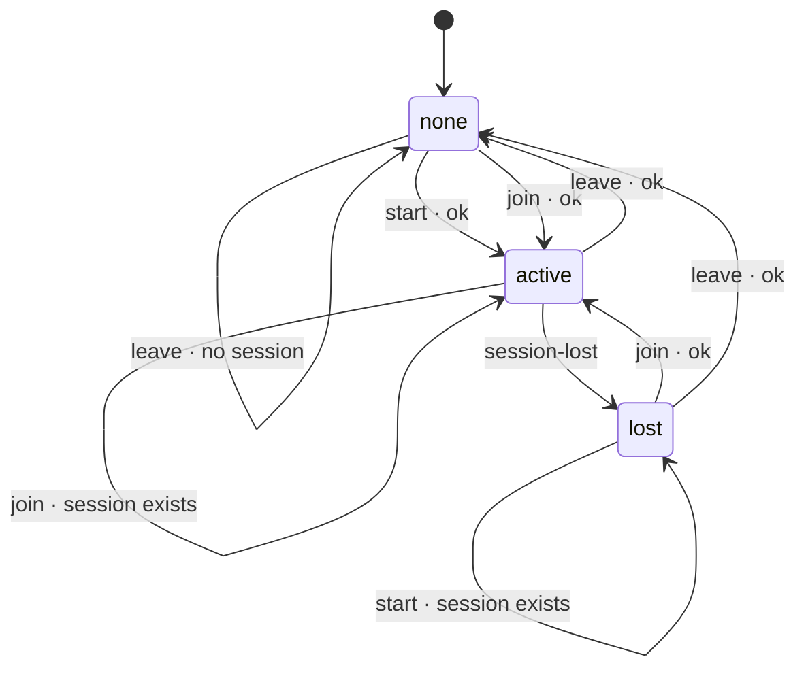

<!-- unifold:generated - do not edit; run `unifold check --fix` -->
# States: plant-data

The states of the contract [plant-data](../references/plant-data/index.md): what a consumer can see of the connection, and the parts that move it from one state to the next. A part that a state does not list must not be called in it. A failure that the table does not name leaves the state as it is.

| State | Part | Result | Next |
|---|---|---|---|
| none | `start` | ok | active |
| none | `join` | ok | active |
| none | `exchange-state` |  | none |
| none | `plants` | no session | none |
| none | `plant` | no session | none |
| none | `history` | no session | none |
| none | `alerts` | no session | none |
| none | `create-plant` | no session | none |
| none | `change-plant` | no session | none |
| none | `remove-plant` | no session | none |
| none | `dismiss-refusal` | no session | none |
| none | `token-for-another-phone` | no session | none |
| none | `leave` | no session | none |
| active | `plants` |  | active |
| active | `plant` |  | active |
| active | `history` |  | active |
| active | `alerts` |  | active |
| active | `exchange-state` |  | active |
| active | `token-for-another-phone` |  | active |
| active | `create-plant` |  | active |
| active | `change-plant` |  | active |
| active | `remove-plant` |  | active |
| active | `dismiss-refusal` |  | active |
| active | `refresh` |  | active |
| active | `leave` | ok | none |
| active | `leave` | network needed | active |
| active | `start` | session exists | active |
| active | `join` | session exists | active |
| active | `session-lost` |  | lost |
| lost | `plants` |  | lost |
| lost | `plant` |  | lost |
| lost | `history` |  | lost |
| lost | `alerts` |  | lost |
| lost | `exchange-state` |  | lost |
| lost | `refresh` |  | lost |
| lost | `start` | session exists | lost |
| lost | `join` | ok | active |
| lost | `leave` | ok | none |
