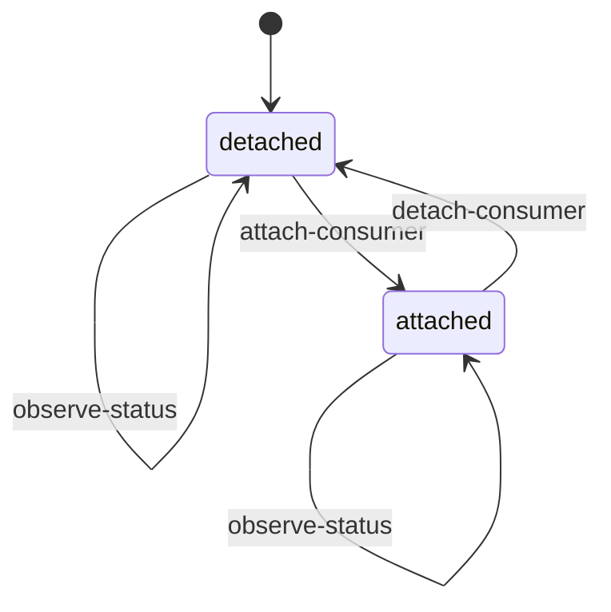

<!-- unifold:generated - do not edit; run `unifold check --fix` -->
# States: sensor-readings

The states of the contract [sensor-readings](../references/sensor-readings.md): what a consumer can see of the connection, and the parts that move it from one state to the next. A part that a state does not list must not be called in it. A failure that the table does not name leaves the state as it is.

| State | Part | Result | Next |
|---|---|---|---|
| detached | `attach-consumer` |  | attached |
| detached | `detach-consumer` |  | detached |
| detached | `observe-status` |  | detached |
| attached | `attach-consumer` |  | attached |
| attached | `detach-consumer` |  | detached |
| attached | `fetch-now` |  | attached |
| attached | `batch` |  | attached |
| attached | `acknowledge` |  | attached |
| attached | `observe-status` |  | attached |
