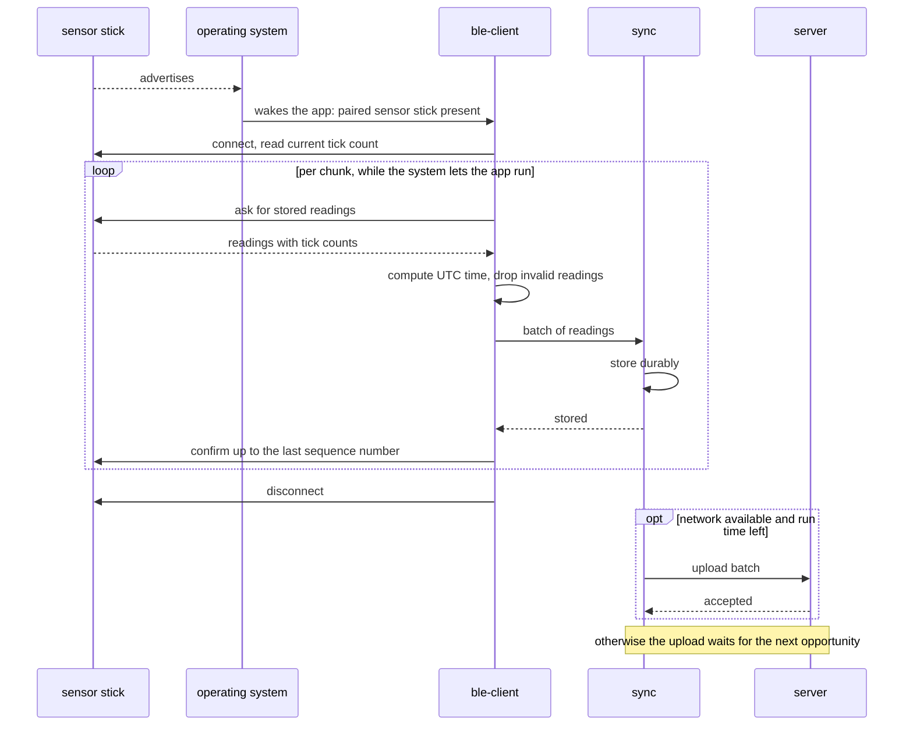
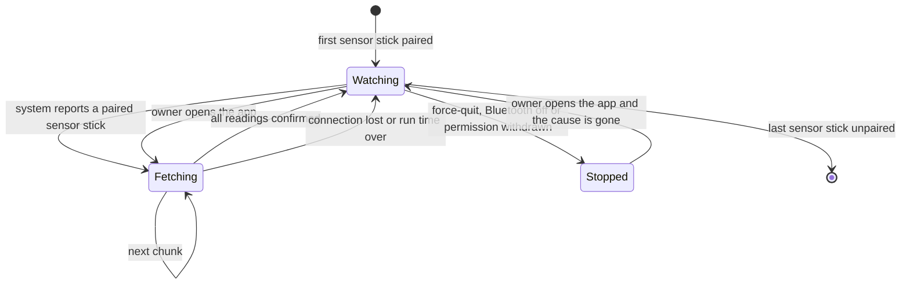
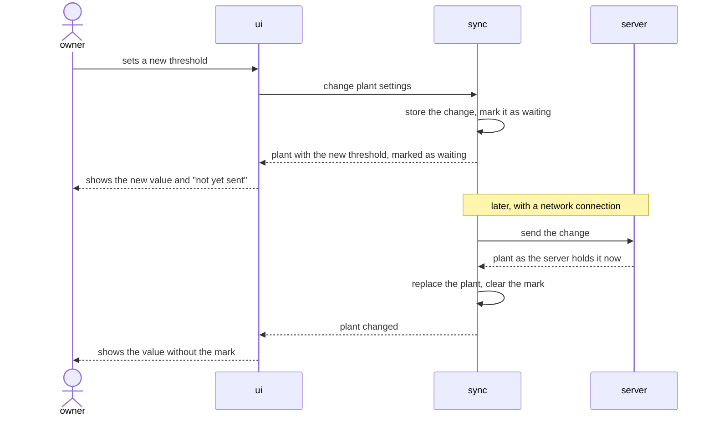

# Runtime of mobile

The scenarios that cross several parts and that no single part can tell. The diagrams show the app's parts [ble-client](../../ble-client/README.md), [sync](../../sync/README.md) and [ui](../../ui/README.md) as participants, next to the outside world.

## A paired sensor stick comes into range while the app is closed

The way of a reading from the sensor stick into the store, and on to the server when there is time. The operating system, `ble-client` and `sync` appear.

## Background fetching as the system sees the app

The states of the whole app between "nothing to do" and "fetching", as the operating system drives them.

In `Watching` the app does not run. The operating system holds the request and starts the app when a paired sensor stick appears. A fetch that ends early loses nothing: the sensor stick still holds every unconfirmed reading.

## The owner changes a threshold without a network connection

A change of the owner on its way through `ui` and `sync` to the server, and what the owner sees meanwhile.

Until the server has the new threshold, alerts follow the old one. The screen says so through the mark.
