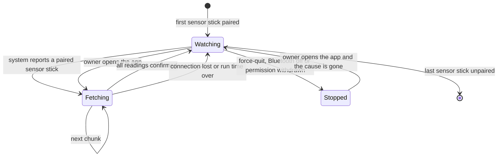

# Runtime of mobile

The scenarios that cross several parts and that no single part can tell. Stories that cross the app's parts [ble-client](../../ble-client/README.md), [sync](../../sync/README.md) and [ui](../../ui/README.md) are scenarios in `unifold.yaml`; the state diagram below is the app as the operating system sees it.

## A paired sensor stick comes into range while the app is closed

The operating system wakes the app when a paired sensor stick advertises nearby. What follows, from the connection to the confirmed readings, is the scenario `fetch-readings` of plantwatch; `ble-client` and `sync` appear in it. A fetch that the system ends early loses nothing: the sensor stick still holds every unconfirmed reading, and the upload waits for the next opportunity with a network connection.

## Background fetching as the system sees the app

The states of the whole app between "nothing to do" and "fetching", as the operating system drives them.

In `Watching` the app does not run. The operating system holds the request and starts the app when a paired sensor stick appears. A fetch that ends early loses nothing: the sensor stick still holds every unconfirmed reading.

## The owner changes a threshold without a network connection

The scenario [change-a-threshold-offline](../diagrams/scenario-change-a-threshold-offline.md) follows a change of the owner through `ui` and `sync` to the server. Until the server has the new threshold, alerts follow the old one. The screen says so through the mark "not yet sent".
