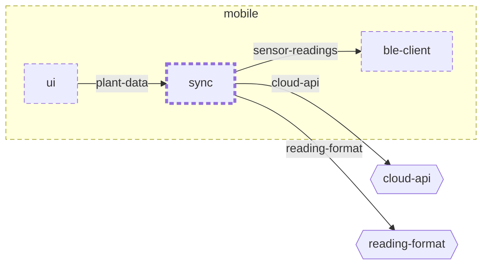

<!-- youmedoc:generated - do not edit; run `youmedoc generate` -->
# Context diagram: sync

[plantwatch](../../../../doc/diagrams/component.md) / [mobile](../../../doc/diagrams/component.md) / **sync** · [README](../../README.md)

`sync` among its siblings inside `mobile`. Only connections that touch `sync` are drawn. Arrows point from the side that needs something to the side that provides it. Rounded nodes are ports the framing unit provides, hexagons are its needs. A dashed arrow is an alternative provider; a dashed border marks a planned unit.

| Unit | Kind | Diagram |
|---|---|---|
| [mobile](../../../README.md) | app | [component](../../../doc/diagrams/component.md) |
| [ble-client](../../../ble-client/README.md) | library | [context](../../../ble-client/doc/diagrams/context.md) |
| [sync](../../README.md) | library | [context](context.md) |
| [ui](../../../ui/README.md) | library | [context](../../../ui/doc/diagrams/context.md) |

### Who provides what this unit needs

| Need | Kind | Own contract | Provided by | Port | Their contract |
|---|---|---|---|---|---|
| sensor-readings | library |  | [mobile/ble-client](../../../ble-client/README.md) | sensor-readings | [contract](../../../ble-client/doc/references/sensor-readings.md) |
| cloud-api | http |  | [cloud/services/gateway](../../../../cloud/services/gateway/README.md) | public-api | [contract](../../../../cloud/services/gateway/doc/references/public-api.md) |
| reading-format | specification |  | [protocol](../../../../protocol/README.md) | reading-schema | [contract](../../../../protocol/doc/references/reading-schema.md) |

### Who uses what this unit provides

| Port | Kind | Used by | As need | Their contract |
|---|---|---|---|---|
| plant-data | library | [mobile/ui](../../../ui/README.md) | plant-data | [contract](../../../ui/doc/references/plant-data.md) |
