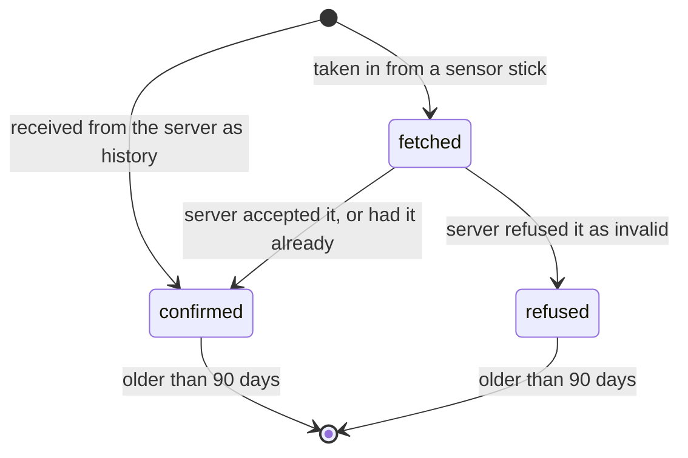

# Local store

What sync keeps on the phone, in which states, and for how long. The things themselves are defined in the data model cited in [context.md](../explanation/context.md). How the exchange with the server moves them between states is in [exchange.md](exchange.md).

## What is kept

| Kept | Identified by | In addition to the data model |
|---|---|---|
| Reading | Sensor id and sequence number | Upload state, and the time it was stored |
| Plant | Plant id | Change state, the waiting change, the reason of a refusal |
| Binding | Plant id and sensor id | From when until when the sensor stick was attached to the plant |
| Alert | Alert id | Nothing |
| Session | Nothing; there is at most one | Whether the server has created the owner yet |
| Exchange record | Nothing; there is one | Time of the last success, the last failure, the current pause |

The token of the session is kept in the phone's protected storage, not in the store.

## Upload state of a reading

| State | Uploaded again | Part of the history | Removed |
|---|---|---|---|
| `fetched` | Yes, until the server answers; only while the server knows its sensor stick as attached to a plant | Yes | Never while in this state |
| `confirmed` | No | Yes | When older than 90 days |
| `refused` | No | Yes | When older than 90 days |

A reading that arrives a second time, from a sensor stick or from the server, changes nothing in the store except this: a `fetched` reading that arrives from the server as history becomes `confirmed`.

## Waiting change of a plant

The store keeps at most one waiting change per plant. It names the settings the owner changed since the plant was last `in step`, with their newest values. A further change of the same plant is merged into it.

| Waiting change | Sent as |
|---|---|
| Plant created on this phone and not yet confirmed | The whole plant |
| Settings changed | The whole plant: the server's current version with the changed settings laid over it |
| Plant removed | A removal; the plant is hidden from all queries meanwhile |
| Created and removed before any exchange | Nothing; both cancel out |

## Retention

| Kept | Removed when |
|---|---|
| Reading, `confirmed` or `refused` | Its time is more than 90 days ago |
| Reading, `fetched` | Never; it waits for the server |
| Reading of a sensor stick that is attached to no plant | Never while `fetched`; it waits until the sensor stick is attached and the server has confirmed the plant |
| Alert, closed | It closed more than 90 days ago |
| Binding that has ended | No reading of its span is left |
| Everything of the owner | The phone has left the owner |

sync removes expired items once a day and after each exchange.

## Size

| Quantity | Upper bound | From |
|---|---|---|
| Readings | 518 400 | 20 sensor sticks, 90 days, 288 readings a day at the shortest sampling interval |
| Plants | 50 | Limit per owner |
| Bindings | Not bounded; in practice a few per plant | |
| Storage used | About 50 MB at the upper bound | About 100 bytes per reading with its index |

## Durability

- A write is complete when it has reached durable storage. Only then does sync acknowledge a batch or return from a command. For a batch of up to 500 readings this takes at most 2 seconds.
- A batch of readings is stored in one transaction: all of its readings or none.
- The store has a layout version. On start, sync migrates an older layout step by step to the current one before it answers any query. It refuses to open a layout that is newer than itself and reports this as a failure of every query and command.
