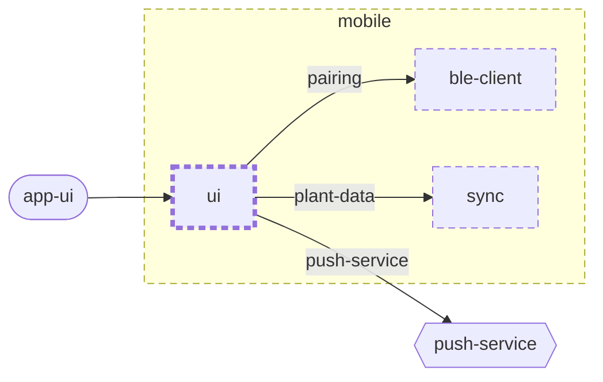

<!-- unifold:generated - do not edit; run `unifold generate` -->
# Context diagram: ui

[plantwatch](../../../../doc/diagrams/component.md) / [mobile](../../../doc/diagrams/component.md) / **ui** · [README](../../README.md)

`ui` among its siblings inside `mobile`. Only connections that touch `ui` are drawn. Arrows point from the side that needs something to the side that provides it. Rounded nodes are ports the framing unit provides, hexagons are its needs. A dashed arrow is an alternative provider; a dashed border marks a planned unit.

| Unit | Kind | Diagram |
|---|---|---|
| [mobile](../../../README.md) | app | [component](../../../doc/diagrams/component.md) |
| [ble-client](../../../ble-client/README.md) | library | [context](../../../ble-client/doc/diagrams/context.md) |
| [sync](../../../sync/README.md) | library | [context](../../../sync/doc/diagrams/context.md) |
| [ui](../../README.md) | library | [context](context.md) |

### Who provides what this unit needs

| Need | Kind | Own contract | Provided by | Port | Their contract |
|---|---|---|---|---|---|
| plant-data | library | [contract](../references/plant-data.md) | [mobile/sync](../../../sync/README.md) | plant-data | [contract](../../../sync/doc/references/plant-data.md) |
| pairing | library |  | [mobile/ble-client](../../../ble-client/README.md) | pairing | [contract](../../../ble-client/doc/references/pairing.md) |
| push-service | http |  | outside the project, as need `push-service` of the root | | |

### Who uses what this unit provides

| Port | Kind | Used by | As need | Their contract |
|---|---|---|---|---|
| app-ui | ui | outside the project, as port `app-ui` of the root | | |
