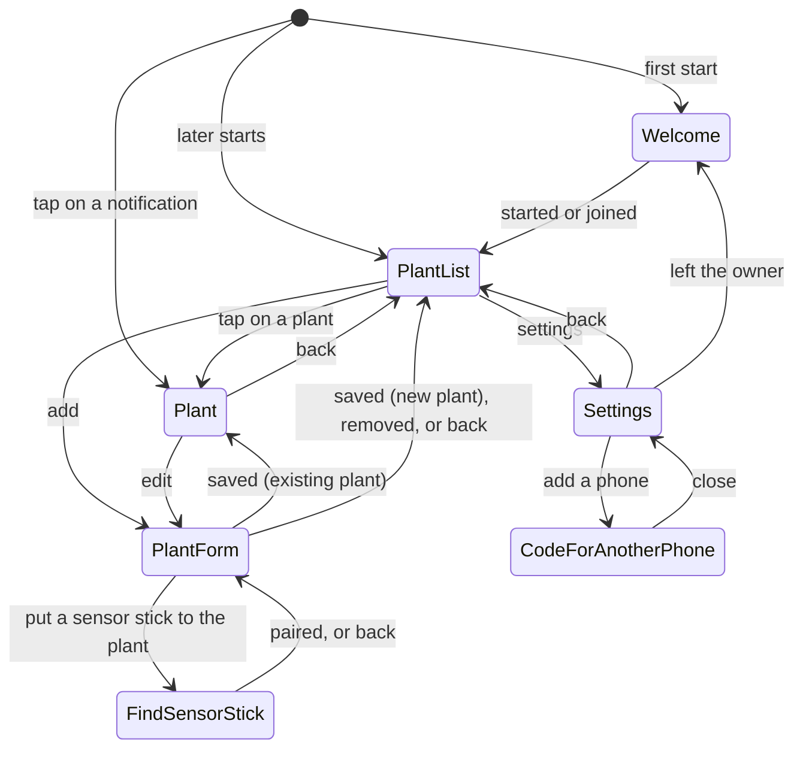

# Screens and navigation: contract of `app-ui`

The screens, the ways between them, and what each screen shows in each
state. The things shown are those of the data model cited in
[context.md](../context.md). The reasons for the navigation are in
[decision 0001](../decisions/0001-the-plant-list-is-home-and-alerts-have-no-screen-of-their-own.md).

## Screens

| Screen | Shows | The owner can |
|---|---|---|
| Welcome | Two choices, shown once | Start, or join an owner by scanning the code on another phone |
| Plant list | Every plant with name, newest soil moisture, age of its readings, and the reasons of its open alerts | Open a plant, add a plant, open the settings, pull down to ask for fresh data |
| Plant | Newest reading with all three quantities, open alerts with reason, start, limit and value, chart of the history, earlier alerts | Change the span of the chart, edit the plant |
| Plant form | Name, the three lower limits, presets, the sensor stick | Save, pick a preset, switch a limit off, put a sensor stick to the plant or release it, remove the plant |
| Find sensor stick | How to open a sensor stick for pairing, then the sensor sticks found, nearest first | Pick one, search again |
| Settings | The paired sensor sticks with their last fetch, the state of the permissions, the time of the last exchange with the server | Unpair a sensor stick, open the system settings, show the code for another phone, leave the owner |
| Code for another phone | A code that carries a token, valid while the screen is open | Close |

## Navigation

A notification about a plant the phone does not hold leads to the plant
list, and the screens ask `plant-data` for fresh data.

## States every screen has

| State | When | The screen shows |
|---|---|---|
| Filled | Data exists | The data |
| Empty | No plant, no reading or no alert exists yet | One sentence that says what is missing and one control that leads to the next step |
| Aged | The newest reading of a plant is older than 24 hours | "No readings since" with the time, and the hint to bring the phone near the plant |
| Server data aged | The last exchange with the server is older than 24 hours | "Alerts may be out of date", with the time of the last exchange |
| Access lost | `plant-data` reports the session as lost | A bar on every screen: "This phone can no longer reach your plants. Join again from another phone." All data stays visible. |
| Permission missing | Bluetooth permission withheld or Bluetooth off | A bar that says no readings are collected and leads to the system settings |

No screen has a loading state for data on the phone. "Find sensor stick",
"Code for another phone" and "pull down" show progress, because they wait
for the outside world.

## Marks on a plant

| Change state | Mark | Where |
|---|---|---|
| `in step` | None | |
| `waiting` | "Not yet sent" | Next to the changed plant in the list and on its screen |
| `refused` | "Not accepted", with the reason and "OK" | On the plant's screen; "OK" dismisses the refusal |

## Chart of the history

| Span | Resolution | Drawn as |
|---|---|---|
| Day | Single readings | Points joined by a line |
| Week | Hours | Line of the mean, band from minimum to maximum |
| 90 days | Days | Line of the mean, band from minimum to maximum |

One quantity is drawn at a time; the owner switches between soil moisture,
light and temperature. The limits of the quantity are drawn as lines. Spans
in which an alert was open are shaded. Light uses a logarithmic axis. A
part of the chart that rests on estimated times is drawn dashed.

## Formats

| Thing | Format |
|---|---|
| Soil moisture | Whole percent |
| Light | Lux, grouped in thousands as the language does |
| Temperature | One decimal, °C |
| Absent value | "no value" |
| Age | Relative up to 7 days ("2 hours ago"), then the date |
| Time | In the phone's time zone; prefixed with "about" if estimated |
| Signal strength | Three steps: near, in the room, far |

## Find sensor stick

| Situation | The screen shows |
|---|---|
| Before the search | "Take the cell out of the sensor stick and put it back in. It can then be paired for a few minutes." and "Search" |
| Search runs, nothing found yet | Progress and "Hold the phone close to the sensor stick" |
| Sensor sticks found | The list; the nearest is preselected after 3 seconds without change |
| Search ended without result | "No sensor stick found", the instruction again, and "Search again" |
| Pairing runs | Progress; the system may show dialogs of its own |
| Pairing failed | The reason in the owner's words and what to do |

| Reason from `pairing` | Text for the owner |
|---|---|
| Not found | "The sensor stick did not answer. Move closer and try again." |
| Refused | "The sensor stick is no longer open for pairing. Put the cell in again and try once more." |
| Declined | "Pairing was cancelled." |
| Limit reached | "This phone already has 20 sensor sticks." |
| Unsupported version | "This sensor stick needs a newer version of the app." |

## Permissions

| Permission | Asked when | Before the system dialog |
|---|---|---|
| Bluetooth | The owner first opens "Find sensor stick" | One screen that says why |
| Camera | The owner first chooses "join" on "Welcome" | One sentence that says why |
| Notifications | The first plant has been saved | One screen that says why; "Not now" is offered |
