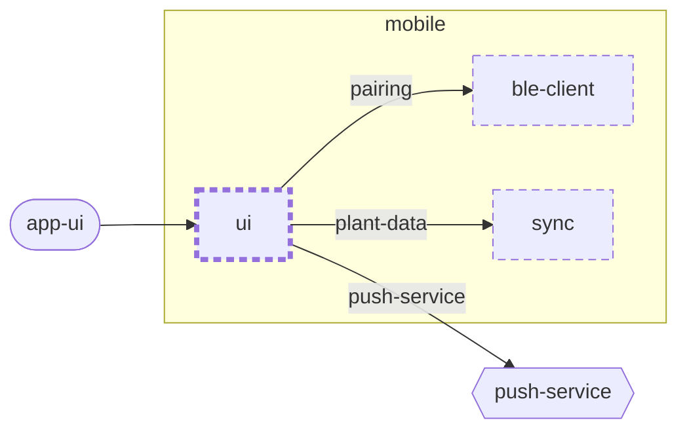

<!-- unifold:generated - do not edit; run `unifold generate` -->
# Context diagram: ui

[plantwatch](../../../../docs/diagrams/component.md) / [mobile](../../../docs/diagrams/component.md) / **ui** · [README](../../README.md)

`ui` inside `mobile`, with the units it is connected to. An arrow points from the unit that needs something to the unit that provides it. Rounded nodes are capabilities of the framing unit, hexagons are its needs. A dashed arrow is an alternative provider; a dashed border marks a unit that is planned.

| Unit | Kind | Summary | Status | Diagram |
|---|---|---|---|---|
| [ble-client](../../../ble-client/README.md) | library | Finds sensor sticks and fetches their readings over BLE | **planned** | [context](../../../ble-client/docs/diagrams/context.md) |
| [sync](../../../sync/README.md) | library | Keeps plants, history and alerts on the phone and in step with the server | **planned** | [context](../../../sync/docs/diagrams/context.md) |
| [ui](../../README.md) | library | Screens of the phone app | **planned** | [context](context.md) |

### Who provides what this unit needs

| Need | Kind | Contract | Provided by | Capability | Verified by |
|---|---|---|---|---|---|
| plant-data | library | [contract](../../../docs/references/plant-data.md) | [mobile/sync](../../../sync/README.md) (planned) | plant-data |  |
| pairing | library | [contract](../../../docs/references/pairing.md) | [mobile/ble-client](../../../ble-client/README.md) (planned) | pairing |  |
| push-service | http | [contract](../../../../docs/references/push-service.md) | outside the project, as need `push-service` of the root | | |

### Who uses what this unit provides

| Capability | Kind | Contract | Verified by | Used by | As need |
|---|---|---|---|---|---|
| app-ui | ui | [contract](../../../../docs/references/app-ui.md) |  | outside the project, as capability `app-ui` of the root | |
