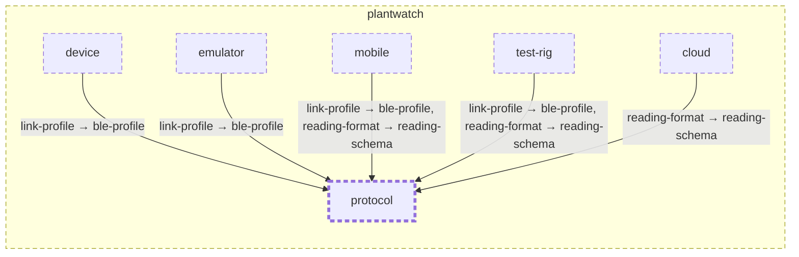

<!-- youmedoc:generated - do not edit; run `youmedoc generate` -->
# Context diagram: protocol

[plantwatch](../../../doc/diagrams/component.md) / **protocol** · [README](../../README.md)

`protocol` among its siblings inside `plantwatch`. Only connections that touch `protocol` are drawn. Arrows point from the side that needs something to the side that provides it. Rounded nodes are ports the framing unit provides, hexagons are its needs. A dashed arrow is an alternative provider; a dashed border marks a planned unit.

| Unit | Kind | Diagram |
|---|---|---|
| [plantwatch](../../../README.md) | system | [component](../../../doc/diagrams/component.md) |
| [cloud](../../../cloud/README.md) | system | [component](../../../cloud/doc/diagrams/component.md) |
| [device](../../../device/README.md) | firmware | [component](../../../device/doc/diagrams/component.md) |
| [emulator](../../../emulator/README.md) | tool | [context](../../../emulator/doc/diagrams/context.md) |
| [mobile](../../../mobile/README.md) | app | [component](../../../mobile/doc/diagrams/component.md) |
| [protocol](../../README.md) | specification | [context](context.md) |
| [test-rig](../../../test-rig/README.md) | test | [context](../../../test-rig/doc/diagrams/context.md) |

### Who uses what this unit provides

| Port | Kind | Used by | As need | Their contract |
|---|---|---|---|---|
| ble-profile | specification | [device/link](../../../device/link/README.md) | link-profile |  |
| ble-profile | specification | [emulator](../../../emulator/README.md) | link-profile |  |
| ble-profile | specification | [mobile/ble-client](../../../mobile/ble-client/README.md) | link-profile |  |
| ble-profile | specification | [test-rig](../../../test-rig/README.md) | link-profile |  |
| reading-schema | specification | [cloud/services/ingest](../../../cloud/services/ingest/README.md) | reading-format |  |
| reading-schema | specification | [mobile/sync](../../../mobile/sync/README.md) | reading-format |  |
| reading-schema | specification | [test-rig](../../../test-rig/README.md) | reading-format |  |
