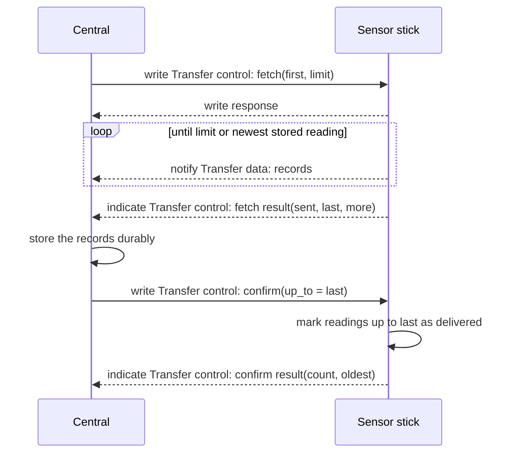

# Procedures

What a central and a sensor stick do, step by step, and what happens when
something fails. Part of the [BLE profile](index.md). Byte layouts, op codes
and result codes are in [characteristics.md](characteristics.md).

## Open a session

1. The central connects to the advertising sensor stick.
2. The central reads Info. If `major` is higher than the highest major
   version the central implements, it disconnects and writes nothing.
3. The central starts encryption. Without a bond it bonds first, which
   succeeds only while
   [bonding is open](advertising-and-connection.md).
4. The central may exchange the ATT MTU.
5. The central enables the indications and notifications it needs.

The central may skip steps 3 to 5 if it only wants Info and Status.

## Take a time reference

A sensor stick has no clock. A reading carries a tick count, and the central
turns it into a UTC time.

1. The central reads Status and notes its own UTC time `T` at the moment
   the response arrives. `B` is `boot_counter` and `S` is
   `seconds_since_boot` of that Status value.
2. For a reading with `boot_counter` equal to `B`:
   `taken_at` = `T` − (`S` − `seconds_since_boot` of the reading), rounded
   to whole seconds, and `time_estimated` is `false`.
3. For a reading with another `boot_counter`, the central uses a time
   reference it has kept for that boot counter and this sensor stick, if it
   has one. `time_estimated` is then `false`.
4. Otherwise the central estimates `taken_at` and sets `time_estimated` to
   `true`. The estimate keeps the order of the readings and is not later
   than the start of the next boot that the central has a reference for.

The central takes the time reference in the same connection as the fetch,
before the fetch. It keeps the newest reference per sensor stick and boot
counter.

## Fetch stored readings and confirm

The sensor stick keeps every reading until a central confirms it. A fetch
changes nothing on the sensor stick. Only a confirm does.

Steps:

1. The central writes `fetch`. `first` is the lowest sequence number it
   wants; 0 or any number below `oldest` means "from the oldest stored
   reading". `limit` bounds the number of records.
2. The sensor stick sends the stored readings with a sequence number of at
   least `first`, in ascending order, as records on Transfer data.
3. The sensor stick indicates the fetch result. The central compares `sent`
   with the number of records it received. If they differ, it discards
   nothing it has, confirms nothing, and fetches again.
4. The central stores the received readings so that they survive its own
   failure.
5. The central writes `confirm` with `up_to` set to a sequence number up to
   which it holds every reading the sensor stick sent, normally `last`.
6. The sensor stick marks every stored reading with a sequence number of at
   most `up_to` as delivered. Such a reading is not sent again and its
   space may be reused. The mark survives a restart of the sensor stick.
7. The sensor stick indicates the confirm result.
8. If `more` was 1, the central repeats from step 1 with `first` set to
   `last` + 1.

Rules:

- `confirm` is cumulative. It covers all readings up to `up_to`, including
  readings the central has never fetched.
- A `confirm` with an `up_to` at or below an earlier one succeeds and
  changes nothing.
- A `confirm` is valid in any connection. A central that lost the
  connection after step 4 confirms in the next connection without fetching
  again.
- The sensor stick sends a reading that it takes during a fetch only if its
  sequence number is within `limit`. `more` tells the central about the
  rest.
- A fetch with nothing to send succeeds with `sent` 0, `last` 0 and
  `more` 0.

## Receive live readings

1. The central enables notifications of Live reading.
2. The central may read Live reading at once to get the newest reading.
3. The sensor stick notifies each new reading at the moment it takes it.

A live reading is not removed from the sensor stick by being notified. The
central recognises it by its sequence number when a fetch delivers it again.
A central that keeps live readings still confirms them only through
`confirm`.

## When something fails

| Event | Sensor stick | Central |
|---|---|---|
| Connection is lost during a fetch | Ends the fetch. Changes no stored reading. | Keeps the complete records it has received. Reconnects later and fetches from its last stored sequence number + 1, or from 0. |
| Connection is lost before the confirm result arrives | Has carried out the confirm, or not | Sends the same `confirm` again in the next connection |
| Central writes `abort` | Stops sending and indicates a fetch result with the result code `aborted` and the true `sent` and `last` | May confirm what it has received |
| `confirm` above the newest reading taken | Changes nothing, result `out-of-range` | Has made an error; reads Status and starts over |
| Sensor stick cannot read or mark its stored readings | Result `storage-failure`, changes nothing | Disconnects and retries later; does not confirm |
| A record is longer than ATT MTU minus 3 | Result `mtu-too-small`, sends no record | Exchanges a larger MTU and fetches again |
| Central receives a record it must reject | Nothing | Drops that record, keeps the others, and still confirms up to `last` |
| Sensor stick restarts | Loses the connection and all descriptor settings. Keeps stored readings and delivered marks. Starts a new boot counter. | Takes a new time reference after reconnecting |
| Stored readings were overwritten | Sets `overflow` in Status until the next successful confirm or restart | Expects a gap in the sequence numbers. No action. |

A reading can reach a central more than once: after a lost connection,
after a lost confirm, as a live reading and in a fetch. The central
recognises it by the sequence number and keeps one copy. This is intended.
