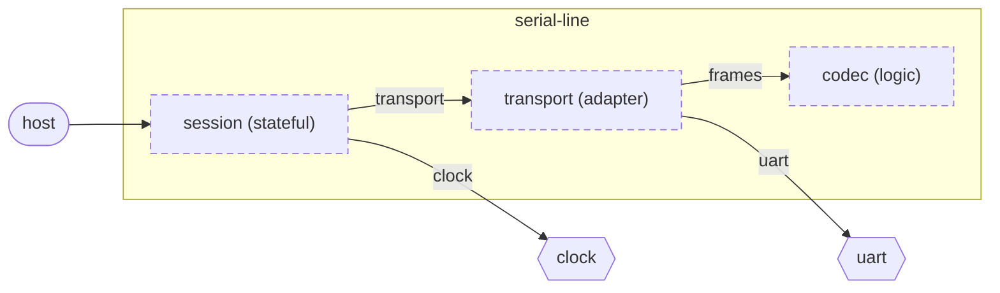

<!-- unifold:generated - do not edit; run `unifold generate` -->
# Component diagram: serial-line

**serial-line** · [README](../../README.md) · [architecture](architecture.md)

The units directly inside `serial-line` and how they are connected. An arrow points from the unit that needs something to the unit that provides it. Rounded nodes are capabilities of the framing unit, hexagons are its needs. A dashed arrow is an alternative provider; a dashed border marks a unit that is planned.

| Unit | Kind | Responsibility | Status | Diagram |
|---|---|---|---|---|
| [codec](../../codec/README.md) | logic | Encodes a payload into the bytes of a frame and decodes a frame from bytes | **planned** |  |
| [session](../../session/README.md) | stateful | Runs the host side of a session through its states and timeouts | **planned** |  |
| [transport](../../transport/README.md) | adapter | Sends and receives frames over the serial line | **planned** | [component](../../transport/docs/diagrams/component.md) |

### Connections

| Need | Provider | Note |
|---|---|---|
| capability `host` of `serial-line` | `session.host` | implemented by |
| `session.transport` | `transport.transport` |  |
| `session.clock` | need `clock` of `serial-line` |  |
| `transport.frames` | `codec.frames` |  |
| `transport.uart` | need `uart` of `serial-line` |  |
