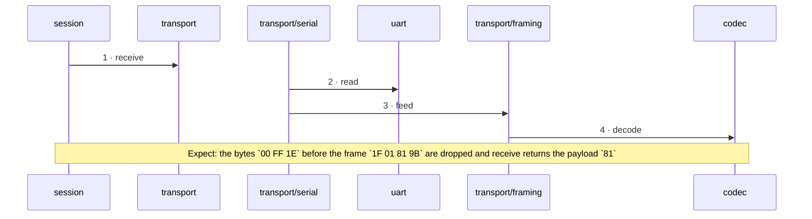

<!-- unifold:generated - do not edit; run `unifold generate` -->
# Scenario: garbage-before-frame

**serial-line** · [README](../../README.md) · [component](component.md) · [architecture](architecture.md)

**Bytes that are not part of a frame arrive before the ACK**
Source: proto §4.3
Expect: the bytes `00 FF 1E` before the frame `1F 01 81 9B` are dropped and receive returns the payload `81`

A unit is named by its path from `serial-line`; a capability or need of `serial-line` is named bare. Every hop is a call along one connection of the map.

| # | Caller | Target | Part | Contract |
|---|---|---|---|---|
| 1 | `session` | `transport` | `receive` | [transport](../references/transport.md) |
| 2 | `transport/serial` | `uart` | `read` | [uart](../references/uart.md) |
| 3 | `transport/serial` | `transport/framing` | `feed` | [framing](../../transport/docs/references/framing.md) |
| 4 | `transport/framing` | `codec` | `decode` | [frames](../references/frames.md) |
