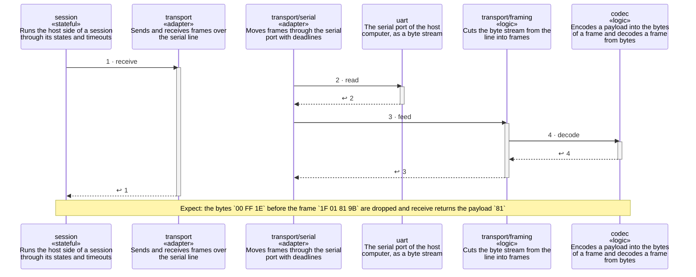

<!-- unifold:generated - do not edit; run `unifold generate` -->
# Scenario: garbage-before-frame

**serial-line** · [README](../../README.md) · [component](component.md) · [architecture](architecture.md)

**Bytes that are not part of a frame arrive before the ACK**
Source: proto §4.3
Expect: the bytes `00 FF 1E` before the frame `1F 01 81 9B` are dropped and receive returns the payload `81`

A unit is named by its path from `serial-line`; a capability or need of `serial-line` is named bare. Every step is one hop along one connection of the map, drawn as the kind of its part says: a command or query goes from the caller to the target, and a dashed arrow brings the result of a query back; an event goes from the provider that raises it to the caller that receives it, with an open arrowhead. A bar is the time a lifeline is busy with a step; it ends when a lifeline further out makes the next step, and a unit below the busy one acts for it. An event from an idle lifeline lands on the bar of a busy receiver, or starts one.

| # | Caller | Target | Part | Kind | Contract |
|---|---|---|---|---|---|
| 1 | `session` | `transport` | `receive` | query | [transport](../references/transport.md) |
| 2 | `transport/serial` | `uart` | `read` | query | [uart](../references/uart.md) |
| 3 | `transport/serial` | `transport/framing` | `feed` | query | [framing](../../transport/docs/references/framing.md) |
| 4 | `transport/framing` | `codec` | `decode` | query | [frames](../references/frames.md) |
