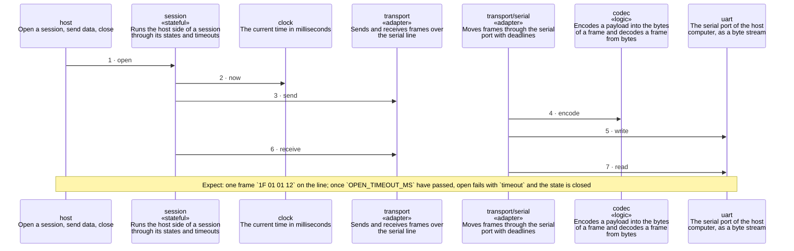

<!-- unifold:generated - do not edit; run `unifold generate` -->
# Scenario: open-times-out

**serial-line** · [README](../../README.md) · [component](component.md) · [architecture](architecture.md)

**The host opens a session and the device stays silent**
Source: proto §5.1, §5.4
Expect: one frame `1F 01 01 12` on the line; once `OPEN_TIMEOUT_MS` have passed, open fails with `timeout` and the state is closed

A unit is named by its path from `serial-line`; a capability or need of `serial-line` is named bare. Every hop is a call along one connection of the map.

| # | Caller | Target | Part | Contract |
|---|---|---|---|---|
| 1 | `host` | `session` | `open` | [host](../references/host.md) |
| 2 | `session` | `clock` | `now` | [clock](../references/clock.md) |
| 3 | `session` | `transport` | `send` | [transport](../references/transport.md) |
| 4 | `transport/serial` | `codec` | `encode` | [frames](../references/frames.md) |
| 5 | `transport/serial` | `uart` | `write` | [uart](../references/uart.md) |
| 6 | `session` | `transport` | `receive` | [transport](../references/transport.md) |
| 7 | `transport/serial` | `uart` | `read` | [uart](../references/uart.md) |
