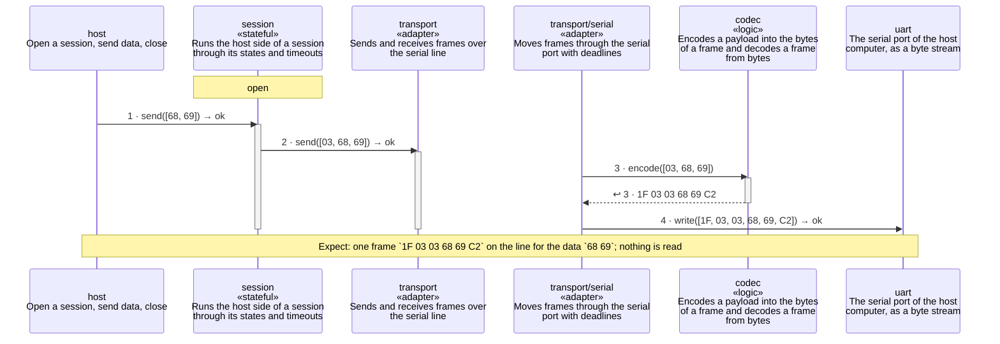

<!-- unifold:generated - do not edit; run `unifold check --fix` -->
# Scenario: send-data

**serial-line** · [README](../../README.md) · [component](component.md) · [architecture](architecture.md)

**The host sends data inside an open session**
Source: proto §5.3
Given: `session.host` is open
Expect: one frame `1F 03 03 68 69 C2` on the line for the data `68 69`; nothing is read

A unit is named by its path from `serial-line`; a capability or need of `serial-line` is named bare. Every step is one hop along one connection of the map, drawn as the kind of its part says: a command or query goes from the caller to the target, and a dashed arrow brings the result of a query back; an event goes from the provider that raises it to the caller that receives it, with an open arrowhead. A bar is the time a lifeline is busy with a step; it ends when a lifeline further out makes the next step, and a unit below the busy one acts for it. An event from an idle lifeline lands on the bar of a busy receiver, or starts one. A step shows its result; a note on a provider's lifeline shows the state of a connection whose contract has states.

| # | Caller | Target | Call | Kind | Result | State | Contract |
|---|---|---|---|---|---|---|---|
| 1 | `host` | `session` | `send([68, 69])` | command | ok | open | [host](../references/host.md) |
| 2 | `session` | `transport` | `send([03, 68, 69])` | command | ok |  | [transport](../references/transport.md) |
| 3 | `transport/serial` | `codec` | `encode([03, 68, 69])` | query | 1F 03 03 68 69 C2 |  | [frames](../references/frames.md) |
| 4 | `transport/serial` | `uart` | `write([1F, 03, 03, 68, 69, C2])` | command | ok |  | [uart](../references/uart.md) |
