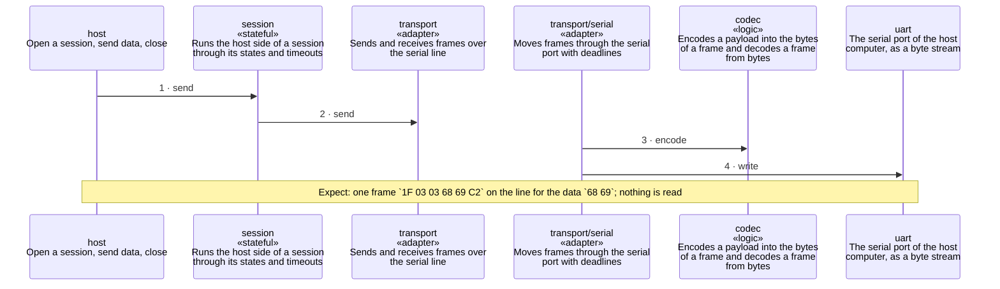

<!-- unifold:generated - do not edit; run `unifold generate` -->
# Scenario: send-data

**serial-line** · [README](../../README.md) · [component](component.md) · [architecture](architecture.md)

**The host sends data inside an open session**
Source: proto §5.3
Expect: one frame `1F 03 03 68 69 C2` on the line for the data `68 69`; nothing is read

A unit is named by its path from `serial-line`; a capability or need of `serial-line` is named bare. Every hop is a call along one connection of the map.

| # | Caller | Target | Part | Contract |
|---|---|---|---|---|
| 1 | `host` | `session` | `send` | [host](../references/host.md) |
| 2 | `session` | `transport` | `send` | [transport](../references/transport.md) |
| 3 | `transport/serial` | `codec` | `encode` | [frames](../references/frames.md) |
| 4 | `transport/serial` | `uart` | `write` | [uart](../references/uart.md) |
