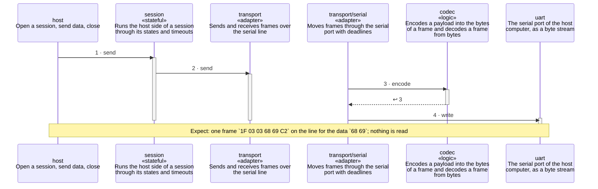

<!-- unifold:generated - do not edit; run `unifold generate` -->
# Scenario: send-data

**serial-line** · [README](../../README.md) · [component](component.md) · [architecture](architecture.md)

**The host sends data inside an open session**
Source: proto §5.3
Expect: one frame `1F 03 03 68 69 C2` on the line for the data `68 69`; nothing is read

A unit is named by its path from `serial-line`; a capability or need of `serial-line` is named bare. Every step is one hop along one connection of the map, drawn as the kind of its part says: a command or query goes from the caller to the target, and a dashed arrow brings the result of a query back; an event goes from the provider that raises it to the caller that receives it, with an open arrowhead. A bar is the time a lifeline is busy with a step; it ends when a lifeline further out makes the next step, and a unit below the busy one acts for it.

| # | Caller | Target | Part | Kind | Contract |
|---|---|---|---|---|---|
| 1 | `host` | `session` | `send` | command | [host](../references/host.md) |
| 2 | `session` | `transport` | `send` | command | [transport](../references/transport.md) |
| 3 | `transport/serial` | `codec` | `encode` | query | [frames](../references/frames.md) |
| 4 | `transport/serial` | `uart` | `write` | command | [uart](../references/uart.md) |
