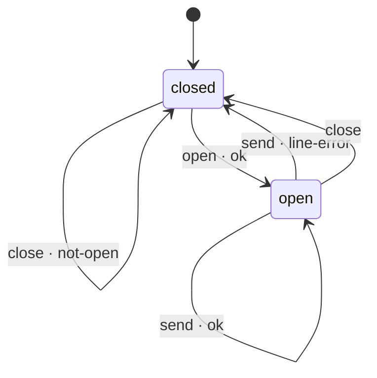

<!-- unifold:generated - do not edit; run `unifold check --fix` -->
# States: host

The states of the contract [host](../references/host.md): what a consumer can see of the connection, and the parts that move it from one state to the next. A part that a state does not list must not be called in it. A failure that the table does not name leaves the state as it is.

| State | Part | Result | Next |
|---|---|---|---|
| closed | `open` | ok | open |
| closed | `send` | not-open | closed |
| closed | `close` | not-open | closed |
| open | `open` | already-open | open |
| open | `send` | ok | open |
| open | `send` | line-error | closed |
| open | `close` |  | closed |
