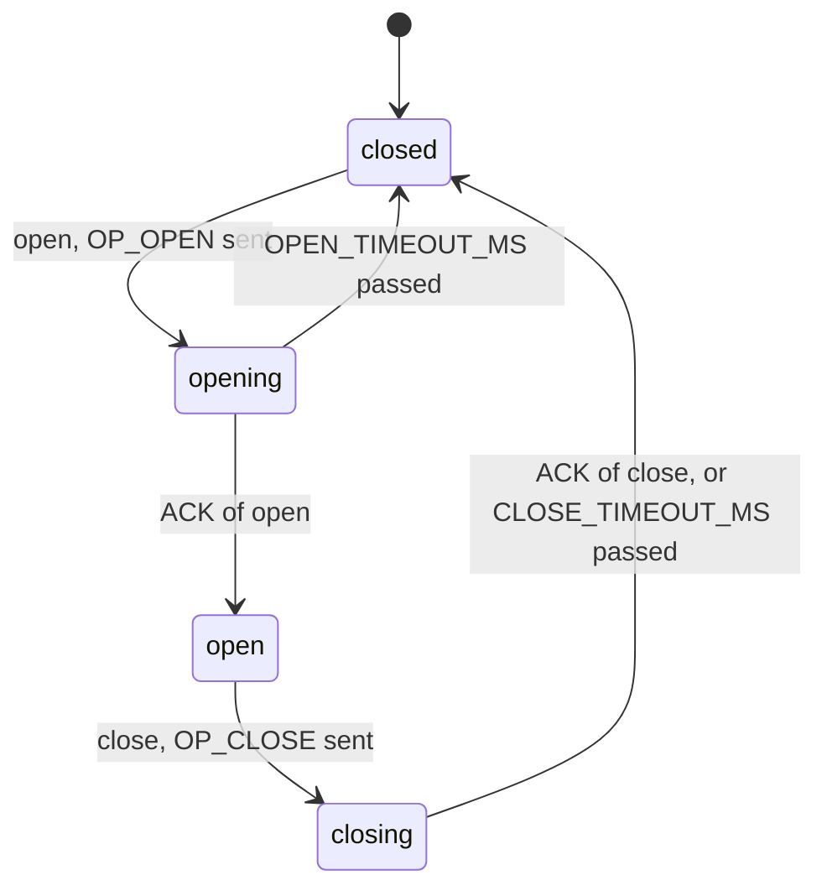

# Runtime of session

The states of the host side and what moves it between them, as the code needs them. Source: proto §5.4, Table 5, through [decision 0001](../decisions/0001-the-session-has-four-states.md).

## States

| State | Enters when | Leaves when | To |
|---|---|---|---|
| closed | start; a close completes; an open fails | `open` is called and `OP_OPEN` was sent | opening |
| opening | `OP_OPEN` was sent | the ACK of open arrives | open |
| opening | | `OPEN_TIMEOUT_MS` pass without it | closed |
| open | the ACK of open arrived | `close` is called and `OP_CLOSE` was sent | closing |
| closing | `OP_CLOSE` was sent | the ACK of close arrives, or `CLOSE_TIMEOUT_MS` pass | closed |

## Timing

- A wait for an ACK is one loop: `receive` with the remaining deadline, computed from `now` at the moment `OP_OPEN` or `OP_CLOSE` was sent. A payload that is not the awaited ACK is ignored and the loop goes on with the remaining time.
- `send` of data awaits nothing.

## Failure

- A `line-error` from `transport` closes the session at once and is reported to the caller.
- A call in the wrong state reports `already-open` or `not-open` and changes nothing.
