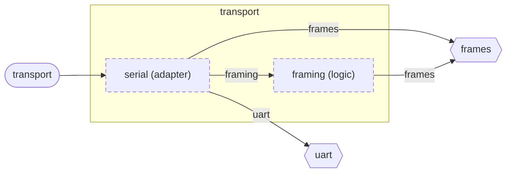

<!-- unifold:generated - do not edit; run `unifold generate` -->
# Component diagram: transport

[serial-line](../../../docs/diagrams/component.md) / **transport** · [README](../../README.md) · [context](context.md)

The units directly inside `transport` and how they are connected. An arrow points from the unit that needs something to the unit that provides it. Rounded nodes are capabilities of the framing unit, hexagons are its needs. A dashed arrow is an alternative provider; a dashed border marks a unit that is planned.

| Unit | Kind | Responsibility | Status |
|---|---|---|---|
| [framing](../../framing/README.md) | logic | Cuts the byte stream from the line into frames | **planned** |
| [serial](../../serial/README.md) | adapter | Moves frames through the serial port with deadlines | **planned** |

### Connections

| Need | Provider | Note |
|---|---|---|
| capability `transport` of `transport` | `serial.transport` | implemented by |
| `serial.framing` | `framing.framing` |  |
| `serial.frames` | need `frames` of `transport` |  |
| `serial.uart` | need `uart` of `transport` |  |
| `framing.frames` | need `frames` of `transport` |  |
