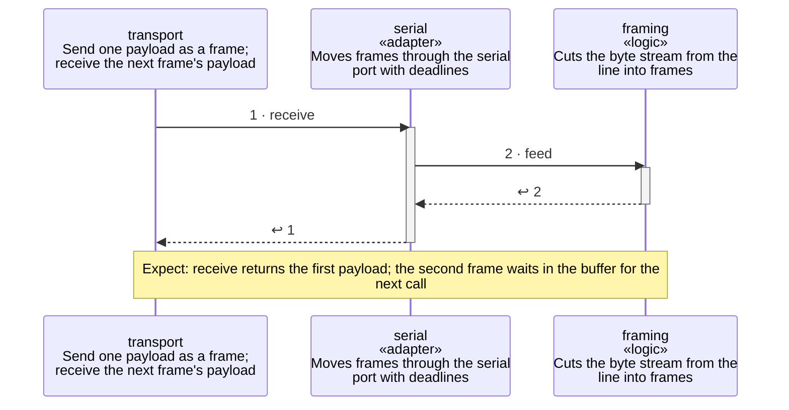

<!-- unifold:generated - do not edit; run `unifold generate` -->
# Scenario: reassemble

[serial-line](../../../docs/diagrams/component.md) / **transport** · [README](../../README.md) · [context](context.md) · [component](component.md)

**Two frames arrive in one read**
Source: proto §4.3
Expect: receive returns the first payload; the second frame waits in the buffer for the next call

A unit is named by its path from `transport`; a capability or need of `transport` is named bare. Every step is one hop along one connection of the map, drawn as the kind of its part says: a command or query goes from the caller to the target, and a dashed arrow brings the result of a query back; an event goes from the provider that raises it to the caller that receives it, with an open arrowhead. A bar is the time a lifeline is busy with a step; it ends when a lifeline further out makes the next step, and a unit below the busy one acts for it.

| # | Caller | Target | Part | Kind | Contract |
|---|---|---|---|---|---|
| 1 | `transport` | `serial` | `receive` | query | [transport](../../../docs/references/transport.md) |
| 2 | `serial` | `framing` | `feed` | query | [framing](../references/framing.md) |
