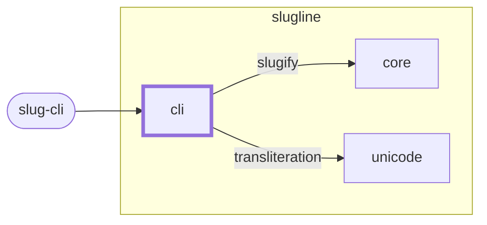

<!-- unifold:generated - do not edit; run `unifold generate` -->
# Context diagram: cli

[slugline](../../../doc/diagrams/component.md) / **cli** · [README](../../README.md)

`cli` among its siblings inside `slugline`. Only connections that touch `cli` are drawn. Arrows point from the side that needs something to the side that provides it. Rounded nodes are ports the framing unit provides, hexagons are its needs. A dashed arrow is an alternative provider; a dashed border marks a planned unit.

| Unit | Kind | Diagram |
|---|---|---|
| [slugline](../../../README.md) | library | [component](../../../doc/diagrams/component.md) |
| [cli](../../README.md) | app | [context](context.md) |
| [core](../../../core/README.md) | library | [context](../../../core/doc/diagrams/context.md) |
| [unicode](../../../plugins/unicode/README.md) | library | [context](../../../plugins/unicode/doc/diagrams/context.md) |

### Who provides what this unit needs

| Need | Kind | Own contract | Provided by | Port | Their contract |
|---|---|---|---|---|---|
| slugify | library |  | [core](../../../core/README.md) | slugify | [contract](../../../core/src/lib.rs) |
| transliteration | library |  | [plugins/unicode](../../../plugins/unicode/README.md) | transliteration |  |

### Who uses what this unit provides

| Port | Kind | Used by | As need | Their contract |
|---|---|---|---|---|
| slug-cli | cli | outside the project, as port `slug-cli` of the root | | |
