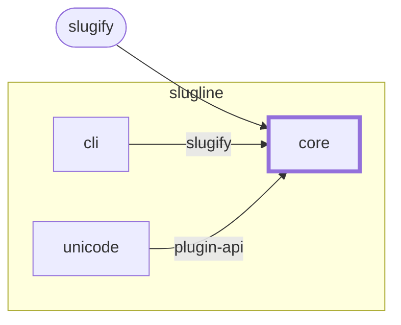

<!-- youmedoc:generated - do not edit; run `youmedoc generate` -->
# Context diagram: core

[slugline](../../../doc/diagrams/component.md) / **core** · [README](../../README.md)

`core` among its siblings inside `slugline`. Only connections that touch `core` are drawn. Arrows point from the side that needs something to the side that provides it. Rounded nodes are ports the framing unit provides, hexagons are its needs. A dashed arrow is an alternative provider; a dashed border marks a planned unit.

| Unit | Kind | Diagram |
|---|---|---|
| [slugline](../../../README.md) | library | [component](../../../doc/diagrams/component.md) |
| [cli](../../../cli/README.md) | app | [context](../../../cli/doc/diagrams/context.md) |
| [core](../../README.md) | library | [context](context.md) |
| [unicode](../../../plugins/unicode/README.md) | library | [context](../../../plugins/unicode/doc/diagrams/context.md) |

### Who uses what this unit provides

| Port | Kind | Used by | As need | Their contract |
|---|---|---|---|---|
| slugify | library | outside the project, as port `slugify` of the root | | |
| slugify | library | [cli](../../../cli/README.md) | slugify |  |
| plugin-api | specification | [plugins/unicode](../../../plugins/unicode/README.md) | plugin-api |  |
