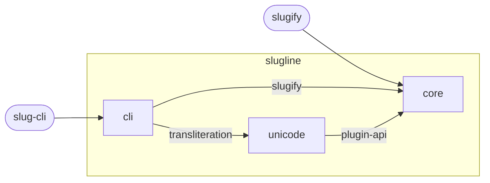

<!-- youmedoc:generated - do not edit; run `youmedoc generate` -->
# Component diagram: slugline

**slugline** · [README](../../README.md) · [context](context.md) · [architecture](architecture.md)

The units directly inside `slugline` and how they are wired. Arrows point from the side that needs something to the side that provides it. Rounded nodes are ports the framing unit provides, hexagons are its needs. A dashed arrow is an alternative provider; a dashed border marks a planned unit.

| Unit | Kind | Summary | Status | Diagram |
|---|---|---|---|---|
| [slugline](../../README.md) | library | Turns any string into a URL slug, as a library and on the command line | active | [component](component.md) |
| [cli](../../cli/README.md) | app | The slugline command | active | [context](../../cli/doc/diagrams/context.md) |
| [core](../../core/README.md) | library | Makes slugs and defines what a transliteration plug-in must offer | active | [context](../../core/doc/diagrams/context.md) |
| [unicode](../../plugins/unicode/README.md) | library | Transliterates Latin characters with diacritics to ASCII | active | [context](../../plugins/unicode/doc/diagrams/context.md) |
