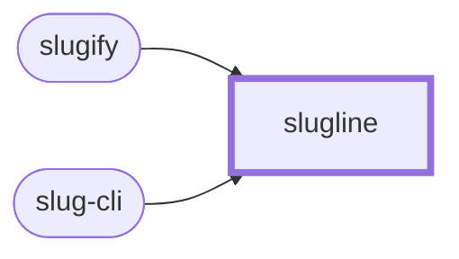

<!-- youmedoc:generated - do not edit; run `youmedoc generate` -->
# Context diagram: slugline

**slugline** · [README](../../README.md) · [component](component.md) · [architecture](architecture.md)

`slugline` and the outside world: the ports it provides (rounded) and the things it needs from outside (hexagons).

| Port | Direction | Kind | Summary |
|---|---|---|---|
| slugify | provided | library | Turn a string into a slug |
| slug-cli | provided | cli | Slugs on the command line |
