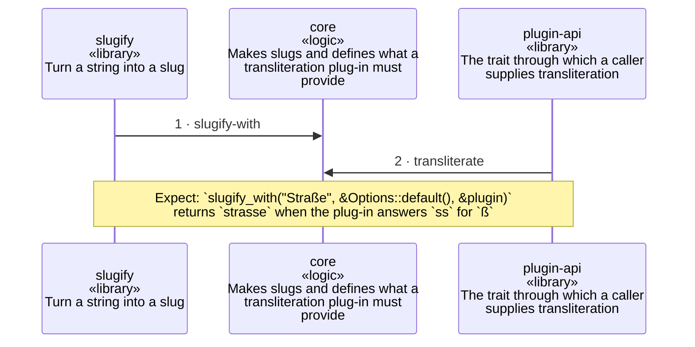

<!-- unifold:generated - do not edit; run `unifold generate` -->
# Scenario: library-call

**slugline** · [README](../../README.md) · [component](component.md)

**A program calls the library with a plug-in of its own**
Source: the tests of core
Expect: `slugify_with("Straße", &Options::default(), &plugin)` returns `strasse` when the plug-in answers `ss` for `ß`

A unit is named by its path from `slugline`; a capability or need of `slugline` is named bare. Every hop is a call along one connection of the map.

| # | Caller | Target | Part | Contract |
|---|---|---|---|---|
| 1 | `slugify` | `core` | `slugify-with` | [slugify](../references/slugify.md) |
| 2 | `plugin-api` | `core` | `transliterate` | [plugin-api](../references/plugin-api.md) |
