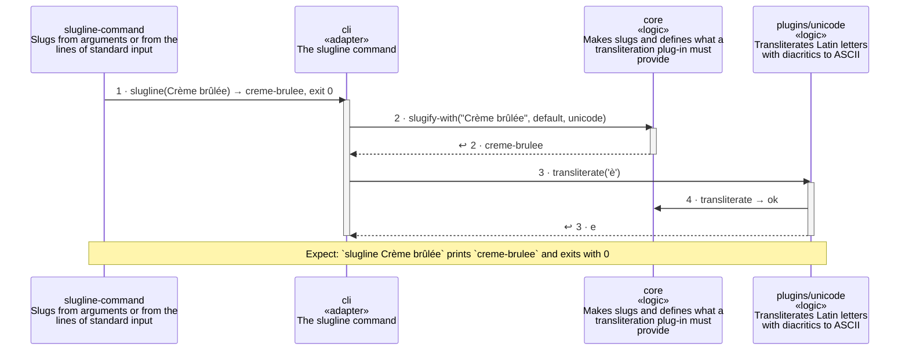

<!-- unifold:generated - do not edit; run `unifold check --fix` -->
# Scenario: slug-from-arguments

**slugline** · [README](../../README.md) · [component](component.md)

**The command turns its arguments into one slug with the plug-in**
Source: the README of the command
Expect: `slugline Crème brûlée` prints `creme-brulee` and exits with 0

A unit is named by its path from `slugline`; a capability or need of `slugline` is named bare. Every step is one hop along one connection of the map, drawn as the kind of its part says: a command or query goes from the caller to the target, and a dashed arrow brings the result of a query back; an event goes from the provider that raises it to the caller that receives it, with an open arrowhead. A bar is the time a lifeline is busy with a step; it ends when a lifeline further out makes the next step, and a unit below the busy one acts for it. An event from an idle lifeline lands on the bar of a busy receiver, or starts one. A step shows its result; a note on a provider's lifeline shows the state of a connection whose contract has states.

| # | Caller | Target | Call | Kind | Result | State | Contract |
|---|---|---|---|---|---|---|---|
| 1 | `slugline-command` | `cli` | `slugline(Crème brûlée)` | command | creme-brulee, exit 0 |  | [slugline-command](../references/slugline-command.md) |
| 2 | `cli` | `core` | `slugify-with("Crème brûlée", default, unicode)` | query | creme-brulee |  | [slugify](../references/slugify.md) |
| 3 | `cli` | `plugins/unicode` | `transliterate('è')` | query | e |  | [transliteration](../references/transliteration.md) |
| 4 | `plugins/unicode` | `core` | `transliterate` | type | ok |  | [plugin-api](../references/plugin-api.md) |
