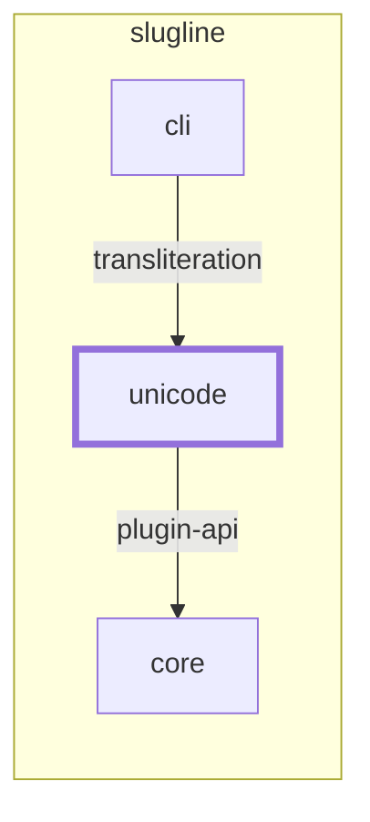

<!-- youmedoc:generated - do not edit; run `youmedoc generate` -->
# Context diagram: unicode

[slugline](../../../../doc/diagrams/component.md) / **unicode** · [README](../../README.md)

`unicode` among its siblings inside `slugline`. Only connections that touch `unicode` are drawn. Arrows point from the side that needs something to the side that provides it. Rounded nodes are ports the framing unit provides, hexagons are its needs. A dashed arrow is an alternative provider; a dashed border marks a planned unit.

| Unit | Kind | Diagram |
|---|---|---|
| [slugline](../../../../README.md) | library | [component](../../../../doc/diagrams/component.md) |
| [cli](../../../../cli/README.md) | app | [context](../../../../cli/doc/diagrams/context.md) |
| [core](../../../../core/README.md) | library | [context](../../../../core/doc/diagrams/context.md) |
| [unicode](../../README.md) | library | [context](context.md) |

### Who provides what this unit needs

| Need | Kind | Own contract | Provided by | Port | Their contract |
|---|---|---|---|---|---|
| plugin-api | specification |  | [core](../../../../core/README.md) | plugin-api | [contract](../../../../core/src/lib.rs) |

### Who uses what this unit provides

| Port | Kind | Used by | As need | Their contract |
|---|---|---|---|---|
| transliteration | library | [cli](../../../../cli/README.md) | transliteration |  |
